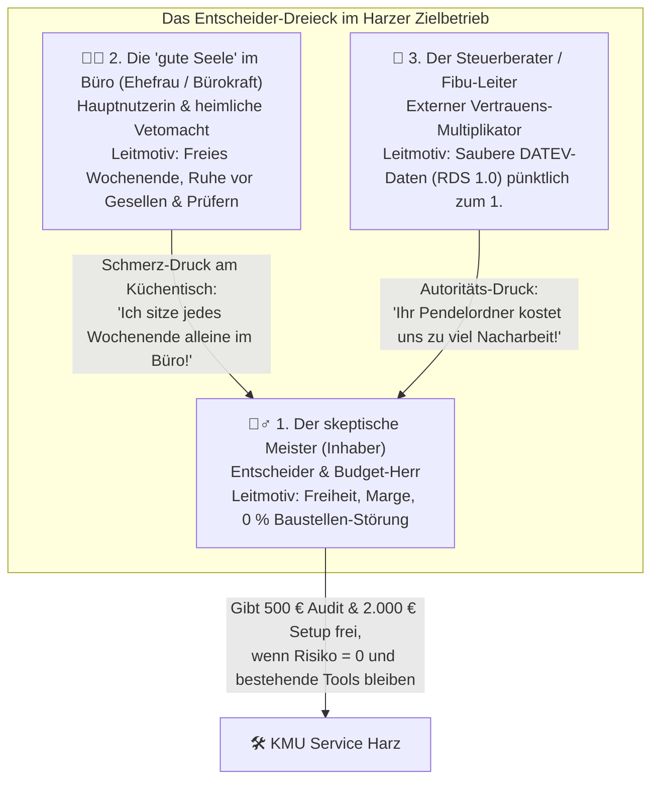

# 🧠 MODUL 1: Kaufpsychologie, Positionierung & Messaging-Bibel
**Projekt:** KMU Service Harz („Der Handwerker für digitale Infrastruktur“)  
**Status:** 🟢 **FINALISIERT & FREIGEGEBEN (100 % einsatzbereit – ohne Platzhalter)**  
**Gültige Leitplanken:** 0 % Pilotprojekte („GoClean Harz“ entfernt), Leitbegriff **„Büro-Wochenende“**, Positionierungs-Speerspitze **Hybrid V2** (Spitzer Einstieg über Beleg/DATEV + sofortige Prozess-Weiche auf Telefon-Ruhe & Baustellen-Doku), **Doppelte Sicherheits-Garantie** beim 500-€-Audit.

---

## 1. DAS ENTSCHEIDER-DREIECK: PSYCHOLOGISCHE TIEFENPROFILE & MESSAGING

In einem inhabergeführten Handwerks- oder Dienstleistungsbetrieb im Harz (3 bis 20 Mitarbeitende) fällt eine Kaufentscheidung für Büro- und Prozessstrukturen niemals im luftleeren Raum. Sie entsteht im Spannungsfeld aus **drei realen Personen**, die völlig unterschiedliche Ängste, Ziele und Vokabulare haben. Wer alle drei mit derselben Botschaft anspricht, verliert.

---

### 👷‍♂️ ROLLE 1: Der skeptische Handwerksmeister (Inhaber, z. B. SHK, Elektro, Dach, Bau)

#### A) Psychologisches Tiefenprofil
- **Realität im Alltag:** Steht von 06:45 bis 17:00 Uhr selbst unter Strom (Baustelle, Materialengpässe beim Großhandel, Krankmeldungen, Kundenrückrufe im Transporter). Ab 18:30 Uhr und am **Büro-Wochenende** wartet die „zweite, unbezahlte Schicht“ am Schreibtisch.
- **Historisches Trauma (Warum er IT-Berater hasst):** Wurde in der Vergangenheit von klassischen IT-Systemhäusern oder Webagenturen verbrannt. Hat tausende Euro für Server, Lizenzen oder eine komplizierte Branchensoftware bezahlt, die am Ende niemand im Team bedienen konnte – abgerechnet über undurchsichtige Stundenzettel à 140 €/Std.
- **Geheimer Groll:** *„Ich habe meinen Meister gemacht, um mein eigener Herr zu sein und gutes Geld mit ehrlicher Arbeit zu verdienen – heute bin ich der bestbezahlte Tipp-Sklave meiner eigenen Firma.“*
- **Entscheidungs-Logik:** Denkt in **Gewerk-Festpreisen** und **Amortisation**. Wenn er eine Wärmepumpe einbaut, nennt er einen Festpreis und garantiert, dass das Haus warm wird. Genau das verlangt er auch von uns.

#### B) Spezifisches Messaging & Kern-Hooks für den Meister
- **Haupt-Versprechen (One-Liner):**  
  > *„Wir schaffen Ihr Büro-Wochenende ab, indem wir WhatsApp, E-Mail, Lexoffice und DATEV lautlos im Hintergrund verbinden – zum festen Paketpreis und ohne dass Ihre Gesellen eine neue App lernen müssen.“*
- **Sprach-Trigger (Was sofort zieht):** *Büro-Wochenende, Feierabend-Büro, Festpreis-Garantie, bestehende Programme bleiben, schlüsselfertig, schwarze Zahlen statt grauer Theorie, Harzer Handschlag.*
- **No-Gos (Was sofort zum Auflegen führt):** *Digitale Transformation, KI-Agenten, Change-Management, Workshop-Reihe, agile Einführung, offener Stundensatz.*

---

### 👩‍💼 ROLLE 2: Die „gute Seele“ im Büro (Mitarbeitende Ehefrau, Partnerin oder Teilzeit-Bürokraft)

#### A) Psychologisches Tiefenprofil
- **Realität im Alltag:** Sie ist der menschliche Puffer zwischen Baustellen-Chaos, ungeduldigen Kunden und dem Steuerberater. Sie sammelt zerknitterte Tankquittungen aus den Mittelkonsolen der Transporter, jagt fehlenden Stundenzetteln hinterher, sucht Baustellenfotos in privaten WhatsApp-Gruppen und sitzt samstags oder sonntags bis 22:00 Uhr über der vorbereitenden Buchhaltung.
- **Tiefste Ängste:**
  1. **Technik-Überforderung:** Angst, vor einem neuen, komplizierten System zu sitzen und „etwas kaputt zu machen“.
  2. **Fronten-Krieg mit den Gesellen:** Wenn eine neue App eingeführt wird, meckern die 55-jährigen Altgesellen *bei ihr* im Büro – nicht beim Chef.
  3. **Prüfungs-Panik:** Unterschwellige Angst vor dem Finanzamt (GoBD / E-Rechnung) oder dem Zoll (Mindestlohn-Stundenaufzeichnung), dass *ihr* ein Fehler angekreidet wird.
  4. **Ersatz-Angst (bei angestellten Bürokräften):** *„Will dieser Berater meinen Arbeitsplatz wegrationalisieren?“* (Muss sofort entkräftet werden: Wir nehmen ihr die stupide Tipp-Arbeit ab, damit sie den Rücken für die echte Organisation frei hat!).

#### B) Spezifisches Messaging & Kern-Hooks für die Bürokraft / Ehefrau
- **Haupt-Versprechen (One-Liner):**  
  > *„Für Sie ändert sich kein einziger gewohnter Programm-Ablauf – außer dass Sie künftig keinen einzigen Beleg mehr abtippen und keinem Zettel aus dem Transporter mehr hinterherlaufen müssen.“*
- **Der Verbündeten-Satz am Telefon (Gatekeeper-Schlüssel):**  
  > *„Frau [Name], ehrlich gesagt rufe ich heute vor allem wegen IHREM Wochenende an. Ich weiß, wer im Handwerksbetrieb am Ende die Quittungen aus dem Auto fischt und dem Steuerberater hinterhertelefoniert. Genau diese Sucherei stellen wir ab – ohne dass Sie oder die Jungs auf der Baustelle ein neues Programm lernen müssen.“*

---

### 👔 ROLLE 3: Der Steuerberater / Kanzleimanager / Fibu-Teamleiter

#### A) Psychologisches Tiefenprofil
- **Realität im Alltag:** Akuter Personalmangel in der Finanzbuchhaltung (Fibu). Jeden Monat um den 8. bis 10. (vor der USt-Voranmeldung) bricht das Chaos aus, weil Handwerks-Mandanten ihre Belege unvollständig, als Papier-Pendelordner oder als lose PDF-Sammlung per Mail reinwerfen.
- **Tiefste Ängste:**
  1. **Unbezahlter IT-Support:** Steuerfachangestellte sollen buchen und beraten – nicht dem Elektromeister erklären, wie er seinen Scanner einrichtet oder warum eine ZUGFeRD-XML-Datei klemmt.
  2. **Verlust der Buchungshoheit (Pfusch im Vorsystem):** Kanzleien hassen es, wenn Mandanten in Tools wie Lexoffice selbst „herumbuchen“ und fehlerhafte Buchungssätze über den *Buchungsdatenservice* in DATEV Kanzlei-Rechnungswesen kippen, die dann mühsam storniert werden müssen.
  3. **Haftungs- & Mandatsrisiko:** Wenn ein externer IT-Dienstleister beim Mandanten Chaos anrichtet, fällt das auf die empfehlende Kanzlei zurück.

#### B) Spezifisches Messaging & Kern-Hooks für die Steuerkanzlei
- **Haupt-Versprechen (One-Liner):**  
  > *„Wir sind Ihre externe Vor-Ort-Werkbank für Ihre chaotischsten Handwerks-Mandanten: Wir richten beim Mandanten den mobilen Belegeingang und die Übergabe via DATEV Rechnungsdatenservice 1.0 (RDS 1.0) inkl. GoBD-Verfahrensdokumentation schlüsselfertig ein – Sie behalten 100 % der Buchungshoheit und bekommen ab dem 1. des Monats lückenlose digitale Belegbilder.“*
- **Technischer Vertrauens-Trigger (RDS 1.0 vs. BDS):**  
  Wir betonen im ersten Satz unaufgefordert: *„Wir nutzen bei Handwerkern strikt den DATEV Rechnungsdatenservice 1.0 (Belegbild + strukturierte XML-Metadaten nach DATEV Belege online), niemals ungeprüfte Selbstbucher-Stapel. Ihre Fibu behält die 100%ige Kontierungshoheit.“*

---

## 2. DIE POSITIONIERUNGS-SPEERSPITZE (HYBRID-MODELL V2), HIMMEL/HÖLLE & 5 FAB-STATEMENTS

### 2.1 Unsere strategische Architektur: „Spitzer Keil rein – Breite Weiche im Gespräch“
Damit wir im Harzer Markt weder als „Bauchladen-Agentur“ (zu breit) noch als „reiner Buchhaltungs-Nerd“ (zu eng, falls die Faktura schon läuft) wahrgenommen werden, gilt im gesamten Marketing-System die **Hybrid-Spitze (Version 2)**:

1. **Der spitze Türöffner nach außen (80 % Fokus in Ads, Briefen, Kaltakquise & Hero-Section):**  
   > **„Schluss mit dem Büro-Wochenende: Lautlose Belegerfassung, E-Rechnung & DATEV-Übergabe für Handwerksbetriebe im Harz.“**  
   *Warum dieser Keil zuerst?* Weil hier der härteste gesetzliche Zwang (B2B-E-Rechnungspflicht + GoBD), der größte familiäre Schmerz (Büro-Wochenende) und der stärkste Multiplikator (Steuerberater) zusammenlaufen.
2. **Die sofortige Diagnose-Weiche im Gespräch (20 % Fokus / Ausbau-Module A & B):**  
   Sobald ein Meister im Gespräch sagt: *„Meine Frau / Lexoffice macht die Rechnungen schon top, das läuft bei uns in 5 Minuten!“*, schalten wir nahtlos auf unsere zwei Ausbau-Module um:
   - **Ausbau-Modul A (Präventive Kundenkommunikation & Auftrags-Sicherung):** Automatische Anfrage-Vorqualifizierung, Termin-Bestätigung und Status-Updates, damit das Telefon auf dem Gerüst/der Baustelle stillsteht und kein Auftrag mehr an die Konkurrenz verloren geht.
   - **Ausbau-Modul B (Lückenlose Baustellen- & Fotodokumentation):** Baustellenfotos, Regiezettel, Abnahmeprotokolle und Winterdienst-/Leistungsnachweise landen vom Monteur-Smartphone in 3 Sekunden automatisch in der richtigen digitalen Projektakte (100 % Schutz bei Reklamationen und Prüfungen).

---

### 2.2 Das Himmel-Hölle-Prinzip (Die 4 psychologischen Kausalketten)
Handwerker kaufen keine „Prozessoptimierung“. Sie kaufen den Ausstieg aus einer schleichenden Abwärtsspirale (**Hölle**) hin zu dem Zustand, wegen dem sie sich ursprünglich selbstständig gemacht haben (**Himmel**):

| Dimension | 🔥 DIE HÖLLE (Ohne System: Das Büro-Hamsterrad) | 🌤️ DER HIMMEL (Mit KMU Service Harz: Der Zielzustand) |
| :--- | :--- | :--- |
| **1. Feierabend & Lebensqualität** | Jeden Abend und jedes **Büro-Wochenende** Belege, Zettel und Angebote abarbeiten ➔ Dauer-Überlastung von Meister & Ehefrau ➔ Der Traum vom freien Meisterbetrieb fühlt sich wie ein goldener Käfig an. | Kaum noch Büroarbeit nach Baustellen-Schluss ➔ **Freie Büro-Wochenenden** für Familie, Kinder und Hobbys ➔ Endlich die Freiheit und Selbstbestimmtheit leben, für die Sie gegründet haben. |
| **2. Kundenfront & Ruf im Harz** | Dauer-Klingeln auf der Baustelle ➔ Rückrufe gehen im Alltag unter ➔ Kunden fühlen sich ignoriert, schreiben 1-Sterne-Bewertungen oder springen ab ➔ Lukrative Aufträge brechen weg. | Kunden erhalten automatisch die richtige Status-Info zur richtigen Zeit (Anfrage, Termin, Nachweis) ➔ Anrufe werden präventiv abgefangen ➔ Ruhe auf der Baustelle und 5-Sterne-Zufriedenheit. |
| **3. Verwaltung & Prüfsicherheit** | Aufträge auf Notizzetteln im Transporter, Fotos in privaten WhatsApp-Chats, fehlende Quittungen ➔ Null Übersicht im Büro ➔ Maximaler Stress bei Steuerberater-Rückfragen, Finanzamt (GoBD) oder Zoll. | Jeder Beleg, jedes Baustellen-Foto und jede E-Rechnung landet automatisch am richtigen Ort ➔ Nichts geht mehr unter ➔ 100 % Übersicht und ruhiger Schlaf vor jeder Betriebsprüfung. |
| **4. Marge & Konkurrenzfähigkeit** | Teure Meisterstunden (65 €+/Std.) oder knappe Bürokräfte werden für stupides Abtippen verbrannt ➔ Hohe Schattenkosten und langsame Angebote ➔ Moderne Mitbewerber ziehen vorbei. | Vereinfachte, lautlose Abläufe im Hintergrund ➔ Voller Fokus auf geldbringende Baustellen, schnelle Angebote und das Team ➔ Wirtschaftlich hochprofitabel und der Konkurrenz voraus. |

---

### 2.3 Die 5 FAB-Statements (Merkmal ➔ Produktvorteil ➔ Kundennutzen)

Jedes Verkaufsargument in unserem System folgt strikt dieser 3-stufigen Übersetzungskette:

| # | 🔵 1. Besonderes Produkt-Merkmal (Feature) | 🟣 + 2. Vorteil des Produkts (Advantage) | 🟢 = 3. Konkreter Vorteil für den Kunden (Benefit) |
| :--- | :--- | :--- | :--- |
| **FAB 1** | **Intelligente System-Brücken & unsichtbare Hintergrund-Verknüpfung** | Verbindet bestehende Programme (WhatsApp, Mail, Lexoffice, DATEV) nahtlos miteinander | **0 % Schulungsaufwand fürs Team – Ihre gewohnten Programme bleiben 1:1 erhalten, niemand muss umlernen.** |
| **FAB 2** | **Standardisiertes Handwerker-Baukastensystem** | Extrem schnell und ohne monatelange IT-Baustelle im Betrieb einrichtbar | **Sie erhalten in nur 10–14 Tagen ein schlüsselfertiges, exakt auf Ihren Betrieb angepasstes System, das sofort Zeit spart.** |
| **FAB 3** | **100 % Spezialisierung auf Handwerksbetriebe & KMU im Harz** | Klare Handwerker-Sprache auf Augenhöhe statt abgehobenem IT-Fachchinesisch | **Blindes Verständnis für Ihren Baustellen-Alltag, volle Transparenz und ein persönlicher Ansprechpartner direkt vor Ort.** |
| **FAB 4** | **100 % GoBD-, E-Rechnungs- & DSGVO-konforme Architektur** | Feste Etablierung geprüfter deutscher Kanzlei- und Sicherheitsstandards (EU-Server + BStBK-Verfahrensdoku) | **Maximale Rechtssicherheit bei Betriebsprüfungen und sorgenfreies Handling sensibler Kunden- und Rechnungsdaten.** |
| **FAB 5** | **Automatische DATEV-Konvertierung & Vorkontierung (RDS 1.0)** | Saubere, lückenlose Direkt-Anbindung an die Software Ihrer Steuerkanzlei | **Keine nervigen Rückfragen mehr am Monatsende, sinkende Steuerberater-Gebühren und blitzschnelle Jahresabschlüsse.** |

---

## 3. ANTI-SYSTEMHAUS-POSITIONIERUNG & WORDING-BIBLE

### 3.1 Konfrontations-Matrix: Klassisches IT-Systemhaus vs. KMU Service Harz

Wir positionieren uns niemals als „noch ein IT-Dienstleister“, sondern als das **pragmatische Gegengift zum klassischen Systemhaus**:

| Vergleichs-Kriterium | ❌ Klassisches IT-Systemhaus / Webagentur | ✅ KMU Service Harz („Handwerker für digitale Infrastruktur“) |
| :--- | :--- | :--- |
| **Abrechnungs-Modell** | Unkalkulierbare Abrechnung nach offenen Stundensätzen (90–160 €/Std.) zzgl. Anfahrt & Ticketgebühren („Fass ohne Boden“). | **100 % garantierte Festpreis-Pakete** (500 € Audit / 2.000 € Setup / 200 € Hausmeister). Kein einziger offener Stundenzettel. |
| **Ökonomischer Anreiz** | Verdient daran, dass Probleme kompliziert sind, lange dauern und neue Hardware/Server verkauft werden („Break-Fix“). | Verdient nur, wenn das System **schnell, schlank und fehlerfrei** steht, weil wir zum Festpreis liefern. |
| **Technischer Fokus** | Physische Hardware, Server-Racks, Firewalls, Windows-Updates und Telefonanlagen. | **Kaufmännische Büro-Entlastung:** Wie kommt der Zettel von der Baustelle ohne Abtippen in die Rechnung und zum Steuerberater? |
| **Umgang mit Bestands-Tools** | *„Sie müssen erst mal für 8.000 € eine komplett neue Komplett-Software kaufen und alle umschulen.“* | **Bestehende Werkzeuge bleiben:** Wir bauen unsichtbare Brücken zwischen WhatsApp, E-Mail, Lexoffice und DATEV. |
| **Sprache & Tonfall** | Elitärer IT-Jargon (*„API-Orchestrierung, Cloud-Migration, Active Directory, SLA-Tiering“*). | **Bodenständiger Handwerker-Klartext** (*„Freies Büro-Wochenende, Beleg-Brücke, 0 % Abtippen, pünktlicher Feierabend“*). |
| **Lösung für E-Rechnung** | Richtet nur ein E-Mail-Postfach ein oder verkauft teure Archiv-Server – der manuelle Tipp-Aufwand bleibt. | **Vollautomatische Prüf- & Durchlauf-Strecke:** E-Rechnung (EN 16931 / ZUGFeRD) wird geprüft, ausgelesen und direkt an DATEV übergeben. |
| **Fokus auf Kleinbetriebe** | Betriebe mit 3–15 Mitarbeitern sind „Beifang“ mit niedriger Priorität; Fokus liegt auf Firmen ab 50 PC-Arbeitsplätzen. | **100 % Maßanzug für 1 bis 20 Mitarbeitende:** Speziell für Betriebe gebaut, in denen Chef und Ehefrau das Büro selbst rocken. |
| **Wartung nach Start** | Reaktiver Helpdesk: Man hängt in der Warteschleife, wenn am Montagmorgen nichts mehr geht. | **Digitaler Hausmeister (200 €/Mo):** Proaktives 24/7-Monitoring – wir reparieren eine geänderte Schnittstelle, *bevor* Sie es im Büro merken. |

---

### 3.2 Die verbindliche Wording-Bible (Jargon-Verbot & Übersetzungstabelle)

> **Eiserne Kommunikations-Regel:** Wenn ein Begriff nicht am Freitagmorgen um 07:00 Uhr an der Theke beim SHK-/Elektro-Großhandel in Goslar sofort verstanden wird, ist er in unseren Texten, Briefen, Anzeigen und auf der Website **verboten**.

#### Verbindliche Leitbegriffe:
- **„Büro-Wochenende“** *(unser primärer Schmerz-Anker – schließt den verhassten Samstagvormittag UND den Sonntagabend am Schreibtisch ein)*
- **„Feierabend-Büro“ / „Die unbezahlte zweite Schicht“** *(unser Anker für die tägliche Arbeit zwischen 18:00 und 21:00 Uhr)*
- **„Der Handwerker für digitale Infrastruktur“** *(unsere Positionierungs-Metapher)*
- **„Digitaler Hausmeister“** *(unser Begriff für den 200-€-Monats-Retainer)*
- **„Unsichtbare Daten-Brücke / Rohrleitung“** *(unser Bild für Schnittstellen)*

#### Die 15-Punkte-Übersetzungstabelle (Verbotener Jargon vs. Handwerker-Klartext):

| ❌ VERBOTENER TECH-JARGON | ✅ HANDWERKER-KLARTEXT (Wortwahl im Marketing & Vertrieb) | 🛠️ Bildhafter Alltagsvergleich fürs Gespräch |
| :--- | :--- | :--- |
| **API / Schnittstelle / Webhook** | **Unsichtbare Daten-Brücke** oder **Direkt-Verbindung zwischen Ihren Programmen** | *„Wie ein fest verlegtes Kupferrohr zwischen zwei Heizkesseln – statt jeden Tag mit dem Wassereimer (Abtippen) hin und her zu laufen.“* |
| **Make.com / n8n / Middleware** | **Unser Hintergrund-Verteiler** oder **Automations-Motor im Schaltschrank** | *„Wie der Sicherungskasten im Keller: Sie müssen ihn nie aufschrauben, er sorgt einfach lautlos dafür, dass überall Strom fließt.“* |
| **OCR / Optical Character Recognition / Vision AI** | **Automatische Beleg-Lesehilfe** (erkennt Betrag, Datum, Lieferant und MwSt. vom Foto) | *„Wie ein digitaler Lehrling mit Adleraugen, der den zerknitterten Tankbeleg in 2 Sekunden abliest und sauber in die Maske einträgt.“* |
| **LLM / OpenAI API / Prompting** | **Intelligente Text- & Sortierhilfe im Hintergrund** | *„Sortiert eingehende Kundenmails und Zettel automatisch in das richtige Fach, ohne dass jemand draufschauen muss.“* |
| **JSON / XML-Parsing (EN 16931)** | **Amtlicher E-Rechnungs-Prüfer (ZUGFeRD / XRechnung)** | *„Prüft wie ein digitaler TÜV-Prüfer am Eingangstor, ob die Rechnung vom Großhandel alle Pflichtfelder für das Finanzamt hat.“* |
| **DATEV RDS 1.0 (gegenüber dem Handwerker)** | **Direkt-Draht zum Steuerberater auf Knopfdruck** *(Hinweis: Gegenüber dem Steuerberater nennen wir bewusst präzise „DATEV Rechnungsdatenservice 1.0“!)* | *„Der digitale Ersatz für den Pendelordner: Belegbild und Rechnungsdaten liegen sofort fertig sortiert bei Ihrer Kanzlei auf dem Tisch.“* |
| **GoBD-Verfahrensdokumentation** | **Ihr Schutzschild-Ordner für die Finanzamt-Prüfung (Ersetzendes Scannen)** | *„Die schriftliche Betriebserlaubnis für das Finanzamt, damit Sie abfotografierte Papierquittungen rechtssicher wegwerfen dürfen.“* |
| **AaaS / Managed Service Retainer** | **Der Digitale Hausmeister (200 € / Monat)** | *„Wie der Wartungsvertrag bei der Heizung: Wir prüfen den Druck auf den Leitungen und tauschen Dichtungen, bevor die Heizung im Winter ausfällt.“* |
| **OAuth-Token-Refresh & Error-Handling** | **Automatische Verbindungs-Wartung & Sicherheits-Stopp** | *„Wenn DATEV oder Lexoffice am Wochenende ein Update fährt, fängt unser Sicherheitsventil den Beleg auf, bis das Tor wieder offen ist.“* |
| **Tripwire / Front-End Offer** | **Das 90-Minuten Büro-Potenzial-Audit (bzw. Büro-Stress-Test)** | *„Wie die Kamerafahrt durchs Abwasserrohr vor der Sanierung: Erst genau schauen, wo die Verstopfung sitzt, dann zum Festpreis beheben.“* |
| **Productized Service / Scope** | **Schlüsselfertiges Festpreis-Paket** | *„Wie ein Komplettbad zum Festpreis – Sie wissen vor dem ersten Hammerschlag auf den Euro genau, was auf der Rechnung steht.“* |
| **Customer Onboarding & Rollout** | **Schlüsselfertige Einrichtung & 14 Tage Begleitung im Alltag** | *„Wir richten alles fix und fertig ein, stellen es mit Ihrem Team kurz scharf und schauen 14 Tage lang bei den ersten 50 Belegen über die Schulter.“* |
| **Cloud-Storage / DMS-Archiv** | **Revisionssicherer digitaler Aktenschrank (auf deutschen/EU-Servern)** | *„Ein digitaler Stahlschrank, in dem Sie jeden Lieferschein und jedes Baustellenfoto von vor zwei Jahren in 3 Sekunden wiederfinden.“* |
| **Lead-Qualification / Booking-Funnel** | **Automatische Vorab-Anfrage & Termin-Vorfilterung** | *„Filtert Reifen-Treter und Preis-Schnorrer auf der Website aus und lässt nur echte Aufträge mit allen Eckdaten in Ihren Kalender.“* |
| **ROI / Amortisationszeit** | **Wann hat sich das Paket von selbst bezahlt gemacht?** | *„Bei 16 gesparten Büro-Stunden im Monat hat sich das 2.000-€-Paket nach 8 Wochen komplett aus eigener Kraft bezahlt.“* |

---

## 4. PROOF-OF-COMPETENCE: VERTRAUENSBEWEIS OHNE PILOTKUNDEN

Da wir strikt **ohne „GoClean Harz“ und ohne erfundene Kunden-Fallstudien** arbeiten, lösen wir das klassische Henne-Ei-Problem (*„Kein Kunde ohne Referenz – keine Referenz ohne Kunde“*) durch drei glasklare, überprüfbare Vertrauensbeweise (**Proof of Competence** statt Social Proof):

### Säule 1: Unser Live-Vorführwagen – Die „Musterbetrieb-Sandbox“ (*Mustermann Haustechnik Harz*)
Ein Handwerksmeister glaubt keinem Hochglanz-Prospekt und auch keinem geduldigen Zitat auf einer Website – er glaubt dem, **was er mit eigenen Augen live funktionieren sieht**.
- **Das Prinzip:** Wir haben einen kompletten, fiktiven Harzer SHK-/Elektrobetrieb (*„Mustermann Haustechnik Harz“*) mit echter WhatsApp-Nummer, E-Mail-Postfach, Lexware-Office-Testumgebung, Google-Drive-Projektakten und DATEV-Export-Vorschau live geschaltet.
- **Der 180-Sekunden-Beweis beim Meister am Tisch:**
  1. Wir legen eine echte Papier-Tankquittung oder Baustoff-Rechnung auf den Tisch des Meisters.
  2. Der Meister (oder wir) macht mit dem ganz normalen Smartphone in WhatsApp ein Foto davon und drückt auf *Senden*.
  3. Wir klappen das Tablet auf: Noch während der Kaffee einläuft (nach ca. 8 Sekunden), ploppt der Beleg fix und fertig ausgelesen (Lieferant, Datum, Netto, 19 % MwSt., Brutto), richtig benannt im Projektordner UND als fertiger Belegentwurf in Lexoffice inkl. DATEV-Übergabeprotokoll auf.
- **Die psychologische Wirkung:** Wer in 180 Sekunden live erlebt, dass die Maschine funktioniert, fragt nicht mehr nach 10 vergangenen Kunden – er fragt: *„Geht das mit unserem Lexoffice / unserem Steuerberater genauso?“*

### Säule 2: Visuelle Vorher-Nachher-Prozesskarten (*„Das Prozess-Röntgenbild“*)
Statt allgemeiner Texte zeigen wir auf der Website, im Handwerker-Brief und im Termin ein visuelles Schaltbild, auf dem jeder Meister seinen eigenen Betrieb sofort wiedererkennt:
- **Links (ROT – Status Quo im typischen 8-Mann-Betrieb):**  
  `Tankquittung / Lieferschein` ➔ `3 Wochen im Fußraum vom Transporter` ➔ `Freitagabend auf den Küchentisch` ➔ `Samstag/Sonntag: Ehefrau tippt Daten in Excel/Lexoffice ab` ➔ `2 Belege fehlen, Rückfrage beim Gesellen` ➔ `Am 10. des Monats Stress mit der Steuerkanzlei` = **32 Std. Verlust / Monat (~1.760 € Schattenkosten)**.
- **Rechts (GRÜN – Nach unserem 2.000-€-Standard-Setup):**  
  `Geselle knipst Beleg an der Tankstelle per WhatsApp (3 Sek.)` ➔ `Hintergrund-Brücke liest Daten aus & legt Beleg GoBD-sicher in Lexoffice ab (0 Sek. Handarbeit)` ➔ `Am 1. des Monats 1-Klick-Übergabe via DATEV RDS 1.0 an die Kanzlei` = **Freies Büro-Wochenende & 0 Rückfragen**.

### Säule 3: Die „Doppelte Sicherheits-Garantie“ beim 500-€-Audit (100 % Risiko-Umkehr)
Wir verschenken das 90-minütige Büro-Potenzial-Audit **niemals kostenlos** (um unsere Zeit vor Gratis-Touristen zu schützen und den Wert hochzuhalten), nehmen dem Meister aber durch unsere **Doppelte Sicherheits-Garantie** jedes finanzielle Risiko komplett ab:

> **🤝 Das Harzer Handschlag-Versprechen für Ihr 500-€-Potenzial-Audit:**
> 1. **100 % Anrechnungs-Garantie:** Wenn Sie sich innerhalb von 30 Tagen nach dem Audit für unser schlüsselfertiges Standard-Setup (2.000 €) entscheiden, schreiben wir Ihnen die 500 € aus dem Audit **zu 100 % auf der Schlussrechnung gut**. Das Audit hat Sie dann effektiv 0 € gekostet.
> 2. **Die 10-Stunden-Ergebnis-Garantie:** Sollten wir in den 90 Minuten wider Erwarten **nicht mindestens 10 Stunden pro Monat** (über 500 € monatlichen Gegenwert) an konkreter, sofort einsparbarer Büro- und Zettelzeit in Ihrem Betrieb aufdecken, zerreißen wir die Rechnung vor Ihren Augen und das Audit kostet Sie **0,00 €**.

---

## 5. DIE EINWANDBEHANDLUNGS-MATRIX: DIE 10 HÄRTESTEN EINWÄNDE (WORT FÜR WORT)

Jede Antwort folgt unserer psychologischen 3-Schritte-Mechanik:  
**1. Validieren (Ego schützen & Druck rausnehmen)** ➔ **2. Reframing / FAB-Hebel (Den Blickwinkel drehen)** ➔ **3. Kalibrierte Gegenfrage (Mikro-Abschluss)**.

---

### Einwand 1: *„Wir haben aktuell überhaupt keine Zeit für eine Umstellung – hier brennt die Hütte!“*
- **Psychologische Wurzel:** Angst, dass wir ihm während der laufenden Baustellen-Saison noch mehr Arbeit und stundenlange Meetings aufhalsen („Säge-schärfen-Paradoxon“).
- **1. Validieren:** *„Herr [Name], das glaube ich Ihnen aufs Wort. Wenn im Harz gerade Hochsaison auf den Baustellen ist, ist jede freie Minute Gold wert.“*
- **2. Reframing:** *„Aber genau weil bei Ihnen die Hütte brennt, rufe ich an. Wir verkaufen Ihnen kein Software-Projekt, bei dem Sie 20 Stunden in Schulungen sitzen müssen. Wir sind Ihr digitaler Hausmeister: Wir brauchen von Ihnen oder Ihrer Frau einmalig 90 Minuten für die Bestandsaufnahme – und danach bauen wir die Daten-Brücken komplett lautlos im Hintergrund auf, während Sie auf der Baustelle stehen.“*
- **3. Gegenfrage:** *„Wenn Sie einmalig 90 Minuten investieren, um danach ab nächsten Monat jedes Büro-Wochenende frei zu haben: Wann tut Ihnen eine kurze Stunde weniger weh – morgens um 07:00 Uhr vor dem Ausrücken oder freitags ab 13:30 Uhr?“*

---

### Einwand 2: *„Wir haben schon ein IT-Systemhaus / einen IT-Betreuer hier in der Region.“*
- **Psychologische Wurzel:** Loyalität zum bestehenden PC-Betreuer und die Annahme, „IT ist gleich IT“.
- **1. Validieren:** *„Perfekt, Herr [Name]! Einen verlässlichen IT-Betreuer für Ihre PCs, Server, FritzBox und Datensicherung brauchen Sie auch weiterhin – dem nehmen wir keinen Millimeter Arbeit weg.“*
- **2. Reframing:** *„Unser Job beginnt genau da, wo das klassische Systemhaus aufhört: Ein Systemhaus sorgt dafür, dass Ihr PC angeht und das Netzwerk läuft. Wir sorgen dafür, dass Ihre Frau am Wochenende keine Tankquittungen und Lieferscheine mehr von Hand in Lexoffice abtippen muss. Wir arbeiten sogar oft Hand in Hand mit den lokalen IT-Häusern, weil die gar keine Zeit und Lust auf Buchhaltungs-Schnittstellen und DATEV-Regeln haben.“*
- **3. Gegenfrage:** *„Hand aufs Herz: Hat Ihr IT-Systemhaus Ihnen schon so eingerichtet, dass ein abfotografierter Beleg vom Transporter in 5 Sekunden automatisch vorkontiert beim Steuerberater liegt – oder tippen Sie das noch selbst?“*

---

### Einwand 3: *„Meine Gesellen (50+) ziehen da nicht mit – die boykottieren jede neue App!“*
- **Psychologische Wurzel:** Gebranntes Kind. Hat schon mal versucht, eine Zeiterfassungs- oder Handwerker-App einzuführen, und ist am Widerstand der Altgesellen gescheitert.
- **1. Validieren:** *„Da sprechen Sie den wichtigsten Punkt überhaupt an. Wenn der 55-jährige Obermonteur auf der Baustelle erst 3 Menüs aufmachen und ein vergessenes Passwort eingeben muss, ist das System nach zwei Tagen tot.“*
- **2. Reframing:** *„Deshalb gilt bei uns die eiserne Gesellen-Garantie: **0 % neue Apps, 0 % Schulung.** Wir nutzen das, was selbst Ihr ältester Geselle jeden Abend auf dem Sofa nutzt: WhatsApp und die normale Handykamera. Er macht ein Foto vom Lieferschein oder spricht 15 Sekunden eine Sprachnachricht ein – fertig. Die ganze schlaue Sortierarbeit passiert unsichtbar bei uns im Hintergrund.“*
- **3. Gegenfrage:** *„Schicken Ihre Jungs Ihnen heute schon manchmal Fotos von der Baustelle oder Krankmeldungen per WhatsApp? [...] Sehen Sie: Wer ein WhatsApp-Foto schicken kann, beherrscht unser System bereits zu 100 %. Wollen wir uns das in 3 Minuten an meinem Vorführ-Handy anschauen?“*

---

### Einwand 4: *„Wir nutzen schon Lexoffice (oder SevDesk / Handwerkersoftware XY) – das reicht uns völlig.“*
- **Psychologische Wurzel:** Verwechslung von „Wir besitzen ein Programm“ mit „Unsere Abläufe sind automatisiert“.
- **1. Validieren:** *„Sehr gut! Wenn Sie Lexoffice schon im Einsatz haben, haben Sie bereits das beste Fundament im Markt. Sie müssen bei uns kein einziges neues Programm kaufen.“*
- **2. Reframing:** *„Die 32 verlorenen Büro-Stunden im Monat entstehen fast nie *in* Lexoffice, sondern auf den 50 Metern *zwischen* Baustelle, E-Mail-Postfach, Lexoffice und Steuerberater: Rechnungen müssen aus 4 verschiedenen E-Mail-Postfächern zusammengesucht werden, Quittungen liegen im Transporter, und Baustellenfotos landen nicht von allein im Kundenordner. Wir reißen Ihr Lexoffice nicht ab – wir verlegen die automatischen Zuleitungsrohre dorthin.“*
- **3. Gegenfrage:** *„Wie kommen denn aktuell die Papierzettel aus den Transportern und die PDF-Rechnungen Ihrer Großhändler in Ihr Lexoffice – läuft das schon zu 100 % ohne händisches Hochladen und Abtippen?“*

---

### Einwand 5: *„2.000 € für das Standard-Setup sind eine Menge Holz – das ist mir zu teuer.“*
- **Psychologische Wurzel:** Preis wird isoliert als Ausgabe betrachtet, nicht im Verhältnis zu den monatlichen Schattenkosten (fehlender Anker).
- **1. Validieren:** *„Ich verstehe Sie vollkommen, Herr [Name]. 2.000 € muss man im Handwerk erst mal ehrlich verdienen, und kein Mensch wirft gern Geld für IT aus dem Fenster.“*
- **2. Reframing:** *„Lassen Sie uns kurz wie Kaufleute rechnen: Ein durchschnittlicher Betrieb Ihrer Größe verliert jeden Monat rund 16 bis 25 Stunden mit Beleg-Sucherei, Abtippen und Steuerberater-Rückfragen. Selbst wenn wir Ihre Stunde oder die Ihrer Büro-Seele nur konservativ mit 55 € ansetzen, verbrennen Sie jeden Monat rund 900 € bis 1.200 € für unproduktive Zettelarbeit – Jahr für Jahr über 10.000 €. Unser 2.000-€-Festpreis stoppt dieses Leck dauerhaft. Das heißt: Nach knapp 8 Wochen hat sich das System komplett selbst abbezahlt, und ab Monat 3 arbeiten Sie jeden Monat rund 900 € reinen Zeitgewinn in die eigene Tasche.“*
- **3. Gegenfrage:** *„Und das Beste: Sie müssen heute überhaupt keine 2.000 € entscheiden. Wir starten immer mit dem 500-€-Audit inklusive unserer 10-Stunden-Ergebnis-Garantie. Erst wenn Sie schwarz auf weiß sehen, dass sich das in unter 8 Wochen für Sie rechnet, entscheiden Sie über den Ausbau. Klingt das kaufmännisch fair?“*

---

### Einwand 6: *„500 € nur für ein Erstgespräch / ein Audit? Andere IT-Firmen machen Angebote kostenlos!“*
- **Psychologische Wurzel:** Verwechslung unseres 90-minütigen Diagnose- & ROI-Audits mit einem verkappten Verkaufsgespräch.
- **1. Validieren:** *„Da haben Sie völlig recht: Ein reines Kennenlerngespräch von 15 Minuten ist bei uns selbstverständlich auch zu 100 % kostenlos.“*
- **2. Reframing:** *„Was andere IT-Systemhäuser ‚kostenlose Beratung‘ nennen, ist in Wahrheit ein Verkaufsgespräch, damit Sie danach einen unberechenbaren Stundensatz-Vertrag unterschreiben. Unser 500-€-Potenzial-Audit ist dagegen wie die professionelle Leckage-Ortung mit der Wärmebildkamera im Heizungsbau: Ich setze mich 90 Minuten mit Ihnen und Ihrer Bürokraft an den Tisch, röntge jeden Beleg- und Auftragsweg und liefere Ihnen einen 4-teiligen schriftlichen ROI-Fahrplan. Und Sie haben null Risiko: Entscheiden Sie sich danach für die Umsetzung, werden die 500 € zu 100 % verrechnet. Und finden wir nicht mindestens 10 Stunden Ersparnis pro Monat, zahlen Sie keinen Cent.“*
- **3. Gegenfrage:** *„Wollen wir vorab einfach die kostenlosen 15 Minuten nutzen, damit ich Ihnen meinen Live-Vorführbetrieb zeige – und Sie entscheiden erst danach, ob das 90-Minuten-Audit für Sie Sinn macht?“*

---

### Einwand 7: *„Mit staatlichen Fördermitteln will ich nichts zu tun haben – zu viel Bürokratie und ewige Wartezeit!“*
- **Psychologische Wurzel:** Schlechte Erfahrungen mit Antragsformularen, ELSTER-Zertifikaten und monatelangem Warten auf Förderbanken (Verbot des vorzeitigen Maßnahmebeginns).
- **1. Validieren:** *„Da bin ich zu 100 % bei Ihnen! Wegen ein paar hundert Euro Zuschuss 8 Wochen auf ein Amt zu warten und Formulare auszufüllen, während im Büro das Chaos weiterläuft, ist wirtschaftlicher Unsinn.“*
- **2. Reframing:** *„Genau deshalb haben wir unser **Standard-Setup für 2.000 € Festpreis** bewusst so schlank kalkuliert, dass Sie **keinen einzigen Förderantrag** brauchen! Wir starten sofort, sind in 10 bis 14 Tagen fertig, und über die gesparte Bürozeit haben Sie das Geld in 8 Wochen wieder drin – schneller als jede Förderbank überhaupt den Eingang Ihres Antrags bestätigt. Staatliche Zuschüsse (wie *Digital Innovation Sachsen-Anhalt* mit 50 % ab 6.000 € oder *INQA-Coaching* mit 80 %) nutzen wir nur dann, wenn Sie später ein großes Komplett-Projekt für den ganzen Betrieb vorhaben – und selbst dann bereiten wir Ihnen die technischen Beschreibungen schlüsselfertig vor.“*
- **3. Gegenfrage:** *„Ist Ihnen beim Start wichtiger, dass das Büro-Wochenende in 14 Tagen ohne Behördenkram erledigt ist, oder planen Sie direkt einen großen Rundumschlag über 6.000 €?“*

---

### Einwand 8: *„Sie sind ja ganz neu am Markt – bei welchen Handwerksbetrieben hier im Harz läuft das denn schon?“* *(Der No-Pilot-Einwand)*
- **Psychologische Wurzel:** Sicherheitsbedürfnis; niemand möchte das „Versuchskaninchen“ eines Anfängers sein.
- **1. Validieren:** *„Eine absolut berechtigte Frage, Herr [Name] – als Handwerksmeister würde ich mir auch niemanden ins Haus holen, der an meiner offenen Kasse erst das Üben anfängt.“*
- **2. Reframing:** *„Genau aus diesem Grund arbeiten wir nach zwei eisernen Grundsätzen: Erstens nennen wir aus strenger Verschwiegenheit gegenüber Steuerkanzleien und Betrieben grundsätzlich keine fremden Firmennamen am Telefon. Zweitens – und das ist viel wichtiger für Sie – müssen Sie mir kein einziges Wort blind glauben: Ich habe unsere komplette Architektur für das Harzer Handwerk in einem voll funktionsfähigen Live-Musterbetrieb (*Mustermann Haustechnik Harz*) aufgebaut. Zudem setzen wir ausschließlich auf millionenfach bewährte deutsche Standard-Schnittstellen (Lexoffice & DATEV RDS 1.0) und testen niemals an echten Kundendaten.“*
- **3. Gegenfrage:** *„Am besten machen wir den echten Handwerker-Test: Sie legen mir beim kurzen Termin Ihren hässlichsten, zerknitterten Beleg aus dem Transporter auf den Tisch, und ich zeige Ihnen live in 3 Minuten am Tablet, wie unser System ihn fehlerfrei in Lexoffice und DATEV übergibt. Wenn das nicht auf Anhieb klappt, gebe ich das Mettbrötchen aus – abgemacht?“*

---

### Einwand 9: *„Wir sind doch nur ein kleiner 4-Mann-Betrieb – so eine Automatisierung lohnt sich nur für große Firmen mit 30 Leuten.“*
- **Psychologische Wurzel:** Verbindet „Digitalisierung/Automatisierung“ mit Konzern-IT (SAP) und unterschätzt den eigenen Stundensatz als Meister.
- **1. Validieren:** *„Das denkt fast jeder kleine Meisterbetrieb zuerst, weil in den Medien immer nur über riesige Industrie-Computer geredet wird.“*
- **2. Reframing:** *„In der Praxis ist es genau umgekehrt: Ein 30-Mann-Betrieb hat zwei vollzeitangestellte Damen im Büro sitzen, die den ganzen Tag nichts anderes machen als Zettel abzutippen. In einem 4-Mann-Betrieb bleibt der ganze Papierkram an Ihnen als Meister und an Ihrer Familie am Wochenende hängen! Jede Stunde, die Sie am Sonntag mit Quittungen verbringen, fehlt Ihrer Erholung oder kostet Sie 65 € Meisterlohn. Gerade für Betriebe zwischen 2 und 10 Mann ist unsere kleine 2.000-€-Brücke der größte Befreiungsschlag überhaupt.“*
- **3. Gegenfrage:** *„Wer sitzt denn bei Ihnen aktuell am Wochenende oder abends nach 19 Uhr am Rechner und macht die Belege für den Steuerberater fertig – Sie selbst oder Ihre Frau?“*

---

### Einwand 10: *„Und was passiert, wenn Lexoffice oder DATEV mal ein Update macht und Ihre Brücke klemmt – oder wenn Sie mal ausfallen?“*
- **Psychologische Wurzel:** Angst vor technischer Abhängigkeit („Vendor Lock-in“) und vor einem Systemstillstand am Monatsende.
- **1. Validieren:** *„Sehr wichtige Frage! Nichts ist schlimmer als eine Technik, die beim Einrichten toll aussieht und nach drei Monaten beim ersten DATEV-Update stillsteht.“*
- **2. Reframing:** *„Dafür haben wir zwei doppelte Böden eingebaut: Erstens gehören alle Konten (Lexoffice, Google, DATEV) und alle dokumentierten Baupläne zu 100 % Ihnen – selbst wenn ich morgen im Harz vom Blitz getroffen werde, fällt Ihr Betrieb niemals aus, weil Ihre Programme im Notfall jederzeit auch ganz normal per Hand bedienbar bleiben. Zweitens bieten wir nach dem Start unseren **Digitalen Hausmeister für 200 € im Monat** (monatlich flexibel) an: Unser Wach-System prüft Ihre Leitungen 24/7 im Hintergrund. Wenn DATEV oder WhatsApp nachts ein Update einspielt, bekommen wir sofort eine Meldung und ziehen die Schraube nach, noch bevor Sie morgens um 7 Uhr den Kaffee aufsetzen.“*
- **3. Gegenfrage:** *„Ist es Ihnen lieber, sich nach der Einrichtung selbst um Updates zu kümmern, oder soll unser Digitaler Hausmeister die Leitungen dauerhaft im Hintergrund für Sie überwachen?“*

---

## 6. SCHNELL-CHECKLISTE FÜR JEDES KUNDENKONTAKT-MEDIUM (MODUL 1 GUARDRAILS)

Vor der Veröffentlichung jedes Briefes, jeder Website-Sektion, jedes Telefon-Skripts und jeder Anzeige (Module 2 bis 9) prüfen wir gegen diese 5 Fragen:
1. **Spricht der Text die konkrete Rolle im Entscheider-Dreieck an?** *(Meister = Festpreis/Feierabend/Marge | Bürokraft = Freies Büro-Wochenende/0 % neue Software | Steuerberater = DATEV RDS 1.0/Buchungshoheit/Pünktlichkeit)*
2. **Ist der Text zu 100 % frei von verbotenem Tech-Jargon?** *(Kein „API“, „Webhook“, „LLM“, „OCR“, „Middleware“ im Kundentext!)*
3. **Wird konsequent der Leitbegriff „Büro-Wochenende“ (bzw. „Feierabend-Büro“) genutzt?**
4. **Werden 0 % erfundene Kundenreferenzen / 0 % „GoClean Harz“ verwendet** und stattdessen die **Musterbetrieb-Sandbox**, das **Prozess-Röntgenbild** und die **Doppelte Sicherheits-Garantie** eingesetzt?
5. **Ist die Fördermittel-Aussage 100 % rechtssicher nach Stand 2026?** *(Kein „Digitalbonus Niedersachsen“! Stattdessen: 2.000-€-Setup amortisiert sich in 8 Wochen ohne Behörden-Wartezeit; ab 6.000 € greifen Digital Innovation Sachsen-Anhalt bis 50 % bzw. INQA-Coaching bis 80 %).*
