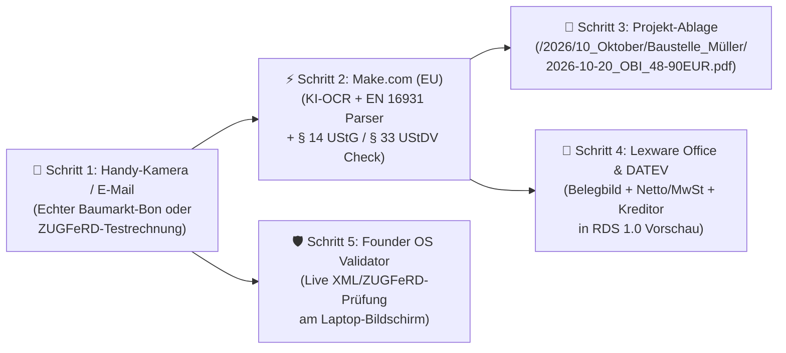
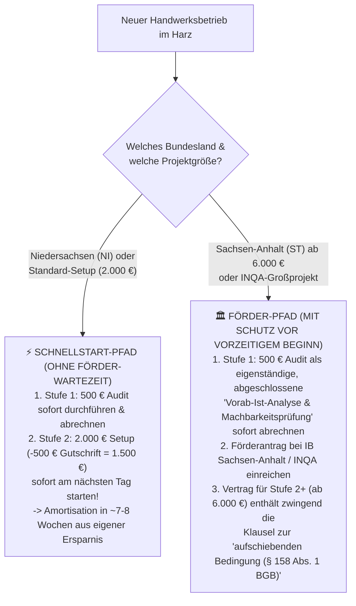

# MODUL 8: Sales Assets, Musterbetrieb-Sandbox („Live-Vorführwagen“) & Rechtliche Leitplanken

**Projekt:** KMU Service Harz (Variablen-Platzhalter für schnellen Rollout)  
**Inhaber & Ansprechpartner:** Robin Gornitzka | 38685 Langelsheim (Landkreis Goslar & Harz)  
**Kontakt:** `kontakt@kmu-service-harz.de` | `+49 (0) 151 / 123 456 78`  
**Fokus:** 3-Minuten-Live-Vorführwagen (`Mustermann Haustechnik Harz`), druckfertige Tisch-Verkaufsunterlagen, das „Altgesellen-Anti-Sabotage-Paket“, rechtliche Absicherung (§ 7 UWG, Fördermittel-Falle, SLA-Schutz) & eigene schlanke System-Architektur (< 350 €/Monat)  
**Status:** 100 % ausgearbeitet – sofort einsatz- und druckbereit (ohne Pilotprojekt-Abhängigkeit)

---

## 1. Die „Musterbetrieb-Sandbox“ (`Mustermann Haustechnik Harz` – Unser Live-Vorführwagen)

### 1.1 Das psychologische Prinzip: Vorführen schlägt Behaupten
Ein Handwerksmeister im Harz hat in den letzten 10 Jahren dutzende Hochglanz-Broschüren von IT-Systemhäusern und Software-Vertretern gesehen. Wenn wir ihm Folien zeigen, denkt er automatisch: *„Papier ist geduldig – bei mir im Betrieb funktioniert das am Ende doch wieder nicht.“*

Deshalb arbeiten wir **ohne Folien-Präsentation** und **ohne erfundene Kunden-Referenzen**. Stattdessen bringen wir unseren eigenen **technischen Vorführwagen** mit an den Küchentisch oder Werkstatttisch: Die voll funktionsfähige Live-Sandbox der fiktiven Musterfirma **„Mustermann Haustechnik Harz“**.

Wenn der Meister seinen eigenen zerknitterten Baumarkt-Kassenbon auf den Tisch legt, ihn mit dem Smartphone abfotografiert und **8 Sekunden später** mit eigenen Augen auf deinem Laptop sieht, wie dieser Bon sauber benannt, mit Netto/MwSt.-Trennung und fertigem Buchungsvorschlag in Lexware Office und der DATEV-Vorschau aufpoppt, ist jede Skepsis sofort gebrochen.

---

### 1.2 Technische Schritt-für-Schritt-Bauanleitung für deine Sandbox

Damit du diesen Vorführeffekt jederzeit in 3 Minuten vor Ort abrufen kannst (auch über deinen Handy-Hotspot), richtest du dir einmalig folgende **kostenlose bzw. extrem günstige Sandbox-Umgebung** ein:



#### Baustein A: Die Stammdaten der Musterfirma (`Mustermann Haustechnik Harz`)
Lege in deiner Test-Umgebung (Lexware Office Test-/Partner-Account + lokaler Ordner + Founder OS) exakt folgende realitätsnahe Stammdaten an, damit sich jeder SHK-, Elektro- oder Dachdeckermeister sofort zu Hause fühlt:
- **Firmenname:** `Mustermann Haustechnik Harz (Musterbetrieb-Sandbox)`
- **Inhaber:** `Meister Klaus Mustermann, 38685 Langelsheim`
- **Kontenrahmen:** `SKR 03` (Standard im Handwerk; alternativ umschaltbar auf `SKR 04`)
- **4 vorab angelegte Test-Lieferanten (Kreditoren):**
  1. `GC-Gruppe / Wilhelm Gienger KG` (Kreditor `70001` – SHK/Großhandel, Sachkonto `3400 Wareneingang 19 %`)
  2. `Sonepar Deutschland Region Nord-Ost GmbH` (Kreditor `70002` – Elektro-Großhandel, Sachkonto `3400 Wareneingang 19 %`)
  3. `OBI Baumarkt Goslar` (Kreditor `70003` – Kleinmaterial/Baustellenbedarf, Sachkonto `4980 Betriebsbedarf`)
  4. `Shell Station B6 Goslar/Langelsheim` (Kreditor `70004` – Kraftstoffe Bulli-Flotte, Sachkonto `4530 Laufende Kfz-Betriebskosten`)
- **3 vorab angelegte Beispiel-Baustellen (Kostenstellen / Projekte):**
  - `KST-101: Badsanierung Familie Müller (Goslar)`
  - `KST-102: Wärmepumpe Neubau Schmidt (Wernigerode)`
  - `KST-103: Kundendienst / Kleinreparaturen (Sammel-KST)`

#### Baustein B: Der Eingangs-Kanal (Smartphone & E-Mail)
1. **Für das Smartphone-Foto am Tisch (2 ausfallsichere Wege):**
   - **Primär-Weg (WhatsApp / Telegram-Bridge):** Eine dedizierte Vorführ-Nummer (WhatsApp Business API oder ein schlanker Telegram-Vorführ-Bot mit Namen *„Mustermann Beleg-Eingang“*), die das Foto + Bildunterschrift (z. B. `Müller`) direkt per Webhook an Make.com sendet.
   - **100-%-Funkloch-Fallback (E-Mail-Kurzwahl):** Auf deinem Handy ist ein Kurzbefehl (*iOS Shortcut* / *Android Quick-Tile*) hinterlegt, der ein aufgenommenes Foto in 1 Sekunde an `beleg@kmu-service-harz.de` (Betreff: `Baustelle Müller`) schickt. Selbst bei schwachem EDGE-Empfang im Oberharz geht diese E-Mail in 3 Sekunden durch.
2. **Für den E-Rechnungs-Test (E-Mail-Postfach):**
   - Halte auf deinem Smartphone einen gespeicherten Entwurf bereit mit einer echten **ZUGFeRD-2.2-Testrechnung** (`GC_Gruppe_Rechnung_2026_88412_ZUGFeRD.pdf`) sowie einer reinen **XRechnung-XML-Datei** (`Landkreis_Goslar_XRechnung_EN16931.xml`).

#### Baustein C: Das Make.com Vorführ-Szenario (4 Module in der EU-Zone `eu1.make.com`)
Baue in deinem Make.com-Account ein schlankes, auf **Sofort-Ausführung (Instant Webhook / Mailhook)** gestelltes Szenario:
- **Modul 1 (Trigger – Custom Mailhook / Webhook):** Empfängt das Belegfoto oder die PDF/XML-Rechnung in Echtzeit (0 Sekunden Wartezeit).
- **Modul 2 (KI-OCR & Struktur-Extraktor via OpenAI GPT-4o-mini / GPT-4o API mit EU-Zero-Data-Retention):**
  - Übergibt das Bild/PDF mit folgendem System-Prompt:
    ```json
    {
      "vendor_name": "Name des Händlers/Lieferanten",
      "invoice_date": "YYYY-MM-DD",
      "invoice_number": "Rechnungs- oder Bon-Nummer",
      "net_amount": 0.00,
      "tax_rate": 19,
      "tax_amount": 0.00,
      "gross_amount": 0.00,
      "is_small_invoice_33_ustdv": true,
      "skr03_account_suggestion": "4980",
      "project_tag": "Baustelle Müller",
      "gobd_check_passed": true
    }
    ```
- **Modul 3 (Automatische Datei-Umbenennung & Projekt-Ordner-Ablage):**
  - Speichert den Beleg automatisch unter dem glasklaren Namen:
    `2026-10-20_OBI-Goslar_48-90EUR_KST-Mueller_Bon-9921.pdf`
  - Legt ihn gleichzeitig im Ordner `/Mustermann_Haustechnik_Harz/01_Eingangsbelege_2026/10_Oktober/` und im Baustellenordner `/Baustellen_2026/Müller_Goslar/Materialbelege/` ab.
- **Modul 4 (Übergabe an Lexware Office `/v1/files` & `/v1/vouchers`):**
  - Lädt das Belegbild samt vorkontierten Metadaten (Lieferant, Datum, Betrag, Steuersatz) direkt in die Buchhaltungs-Vorschau hoch, wo es sofort im Reiter *„Zu prüfende Belege / DATEV-Bereitstellung“* erscheint.

#### Baustein D: Die Requisiten in deiner Vorführ-Mappe (Zum Anfassen!)
Nimm zu jedem Vor-Ort-Termin in deiner Klemmbrett-Mappe diese **3 physischen Originale** mit:
1. **Einen echten, leicht zerknitterten Baumarkt-Kassenbon** (z. B. OBI Goslar über 48,90 € für Silikon, Dübel und Dichtband) – idealerweise mit einem kleinen Kaffeerand.
2. **Einen echten Tankstellen-Beleg** (z. B. Shell Langelsheim über 112,40 € Diesel).
3. **Einen ausgedruckten Screenshot einer nackten XRechnung-XML-Datei** (voller `<ram:IncludedSupplyChainTradeLineItem>`-Codezeilen), um den Kontrast zwischen „Steuer-Chinesisch“ und unserer 1-Klick-Lösung sofort greifbar zu machen.

---

### 1.3 Die 3-Minuten-Vorführ-Choreografie am Tisch (Sekunde 0 bis 180)

> [!TIP]
> **Goldene Vorführ-Regel:** Lass den Meister oder die Bürokraft das Handy möglichst **selbst in die Hand nehmen** und auf den Auslöser drücken. Wer selbst drückt, begreift körperlich, wie einfach es ist!

| Zeitfenster | Was du tust (Handlung am Tisch) | Was du wörtlich sagst (Skript) |
|---|---|---|
| **Sek. 0–30: Der Haptik-Anker** | Du klappst den Laptop auf (verbunden mit deinem Handy-Hotspot). Du legst den zerknitterten OBI-Kassenbon (48,90 €) mitten auf den Tisch. | *„Herr [Nachname], Frau [Nachname], ich zeige Ihnen heute keine PowerPoint-Folien. Wir schauen uns das live an unserer Musterfirma ‚Mustermann Haustechnik Harz‘ an. Stellen Sie sich vor, Ihr Geselle Kalle kommt gerade vom OBI in Goslar und hat diesen Bon hier für die Baustelle Müller in der Hand.“* |
| **Sek. 30–60: Der 8-Sekunden-Schuss** | Du hältst das Smartphone über den Bon, machst ein Foto, tippst darunter nur das Wort `Müller` (oder sprichst 2 Sekunden ein: *„Baustelle Müller“*) und drückst auf Senden. | *„Normalerweise fliegt dieser Bon jetzt aufs Armaturenbrett, bleicht in der Sonne aus und fehlt Ihnen am Monatsende. Bei uns macht Ihr Geselle vor dem Losfahren genau das hier: Foto, Wort ‚Müller‘ drunter, absenden. Das waren 8 Sekunden. Mehr muss Ihr Mitarbeiter niemals tun.“* |
| **Sek. 60–120: Der Aha-Moment im Büro** | Du drehst den Laptop-Bildschirm um 15 Grad zum Meister und zur Bürokraft. In diesem Moment ploppt der Beleg im Baustellenordner `Müller_Goslar` und in der Buchhaltungs-Vorschau auf. | *„Und jetzt schauen Sie mal auf den Bildschirm, was gerade im Hintergrund passiert ist – ohne dass im Büro jemand eine Taste gedrückt hat: Der Bon heißt nicht mehr `IMG_4829.jpg`, sondern `2026-10-20_OBI_48-90EUR_Baustelle-Mueller.pdf`. Er liegt erstens schon fertig in der Baustellenakte Müller, damit Sie die 48,90 € beim Kunden nicht vergessen abzurechnen. Und zweitens steht er hier schon fertig mit Netto, 19 % MwSt. und Sachkonto für Ihren Steuerberater bereit.“* |
| **Sek. 120–180: Der E-Rechnungs-Beweis** | Du öffnest kurz die rohe XML-Rechnung auf dem Bildschirm und ziehst sie danach per Maus in den **E-Rechnungs-Validator** deines Founder OS (`EInvoiceValidatorView`). Sofort leuchtet das grüne EN-16931-Prüfsiegel auf. | *„Und falls der Großhändler oder die Kommune Ihnen so eine neue E-Rechnung als kryptische XML-Datei schickt, müssen Sie keine Angst vor diesem Code-Salat haben. Unser System prüft in 2 Sekunden, ob alle Pflichtfelder nach Gesetz stimmen, macht ein lesbares Blatt daraus und legt es revisionssicher ab. Wie viel entspannter wäre Ihr Freitagabend, wenn das ab nächster Woche bei Ihnen genauso durchläuft?“* |

---

## 2. Physische Verkaufsunterlagen (Druckvorlagen im Klartext)

### 2.1 Unterlage 1: Der Tisch-One-Pager („Das Prozess-Röntgenbild & Festpreis-System“)
*(Format: DIN A4, beidseitig auf 120g-Papier gedruckt. Liegt beim Gespräch offen zwischen dir und dem Meister auf dem Tisch, damit du mit dem Stift darauf zeigen kannst.)*

```text
================================================================================
[VORDERSEITE DIN A4 – DER TISCH-ONE-PAGER]
================================================================================

KMU SERVICE HARZ | Robin Gornitzka | 38685 Langelsheim (Landkreis Goslar & Harz)
Der „Handwerker für digitale Infrastruktur“ – Schluss mit dem Büro-Wochenende!

--------------------------------------------------------------------------------
1. DAS PROZESS-RÖNTGENBILD: WO IHR BETRIEB AKTUELL JEDEN MONAT ~16 STUNDEN VERLIERT
--------------------------------------------------------------------------------

[ ❌ VORHER: DAS ZETTEL- & MEDIENBRUCH-CHAOS (~32 Std./Monat Büro-Falle) ]
  (1) Baustelle & Bulli        (2) Feierabend & Sonntag     (3) Monatsanfang Kanzlei
  • Quittungen im Fußraum      • WhatsApp-Fotos suchen      • Pendelordner packen
  • Unleserliche Rapporte      • Zahlen händisch abtippen   • Rückfragen vom StB
  • E-Mails in 3 Postfächern   • Material vergessen!        • Verlorene Vorsteuer

                     ║  WIR BAUEN DIE LAUTLOSE BRÜCKE (OHNE NEUE APPS!)  ║
                     ▼                                                   ▼

[ ✅ NACHHER: DER 8-SEKUNDEN-BELEGWEG (~90 % WENIGER TIPPARBEIT) ]
  (1) 8-Sekunden-Erfassung     (2) Automatische Sortierung  (3) 1-Klick DATEV & Archiv
  • Foto per Handy an der      • Automatische Auslesung     • Belegbild + Metadaten
    Kasse + Stichwort            (Netto, MwSt., Lieferant)    fertig im DATEV RDS 1.0
  • E-Rechnungs-Wächter        • Kopie landet direkt in     • GoBD-Verfahrensdoku für
    prüft XML/ZUGFeRD live       der richtigen Bauakte        das Finanzamt inklusive

--------------------------------------------------------------------------------
2. DER HIMMEL-HÖLLE-VERGLEICH IM HANDWERKSALLTAG
--------------------------------------------------------------------------------
| Bereich            | 🔥 Ohne System (Status Quo)      | 🌤️ Mit KMU Service Harz          |
|--------------------|----------------------------------|----------------------------------|
| Chef-Wochenende    | Sonntags 3–4 Std. Belege suchen  | Freies Wochenende & freier Kopf  |
| Material-Abrechnung| Vergessene Bons = 0 € Marge      | Jeder Bon sofort in der Bauakte  |
| Finanzamt & GoBD   | Lose Zettel & ungeprüfte PDFs    | 100 % prüfsicher nach EN 16931   |
| Steuerberater      | Hohe Nachbuchungsgebühren        | Schnelle BWA & sinkende Kosten   |

================================================================================
[RÜCKSEITE DIN A4 – UNSere 5 GARANTIEN & DIE 3-STUFEN-FESTPREIS-TREPPE]
================================================================================

3. UNSERE 5 HANDWERKER-GARANTIEN (WARUM WIR KEIN IT-SYSTEMHAUS SIND)
--------------------------------------------------------------------------------
✔ 1. KEINE NEUEN APPS FÜR IHRE MONTEURE:
     Wer ein Handy-Foto machen kann, kann unser System bedienen. Ihre bestehenden
     Programme (Lexware Office, sevDesk, Handwerker-Software, DATEV) bleiben!
✔ 2. IN 14 TAGEN STARTKLAR STATT MONATELANGER IT-PROJEKTE:
     Wir nutzen praxiserprobte Standard-Bausteine speziell für Harzer Betriebe.
✔ 3. 100 % HANDWERKER-KLARTEXT:
     Kein IT-Fachchinesisch, keine offenen Stundensätze, ein fester Ansprechpartner
     direkt hier aus Langelsheim/Goslar.
✔ 4. INKLUSIVE GOBD-VERFAHRENSDOKUMENTATION (WERT: 400 €):
     Damit Sie Papierbelege nach dem Fotografieren offiziell vernichten dürfen.
✔ 5. SAUBERE DATEV-TRENNUNG (RDS 1.0):
     Ihr Steuerberater behält zu 100 % die Buchungshoheit – wir liefern ihm nur
     perfekt lesbare, vorsortierte Belegbilder und Rechnungsdaten.

--------------------------------------------------------------------------------
4. UNSERE TRANSPARENTE 3-STUFEN-FESTPREIS-TREPPE (NETTO ZZGL. UST.)
--------------------------------------------------------------------------------

+------------------------------------------------------------------------------+
| STUFE 1: DAS 90-MINUTEN VOR-ORT-POTENZIAL-AUDIT                 500,00 €     |
| • Komplette Ist-Aufnahme Ihrer Beleg-, Stundenzettel- & Büro-Abläufe         |
| • Schriftliches Prozess-Röntgenbild + exakte Schattenkosten-Berechnung       |
| • 🛡️ DOPPELTE SICHERHEITS-GARANTIE:                                          |
|   1. Finden wir nicht mind. 10 Std./Monat Einsparpotenzial -> 0,00 € Kosten! |
|   2. Bei Umsetzung (Stufe 2) binnen 30 Tagen -> 100 % Anrechnung (-500 €)!   |
+------------------------------------------------------------------------------+
                                       ▼
+------------------------------------------------------------------------------+
| STUFE 2: SCHLÜSSELFERTIGES STANDARD-SETUP (IN 14 TAGEN)       2.000,00 €     |
| • Abzüglich 100 % Audit-Gutschrift (-500 €) = NUR 1.500,00 € RESTINVESTITION |
| • Komplette Einrichtung: 8-Sekunden-Belegweg, E-Rechnungs-Wächter,           |
|   Projektordner-Sortierung, DATEV/Lexware-Brücke & GoBD-Verfahrensdoku       |
| • Inklusive 5-Minuten-Hof-Einweisung & laminierter Bulli-Karten fürs Team    |
| • ⚡ Amortisiert sich durch ~16 Std./Monat Zeitgewinn in ca. 7–8 Wochen!     |
|   *(Für Großprojekte ab 6.000 € in Sachsen-Anhalt bis zu 50 % IB-Förderung)* |
+------------------------------------------------------------------------------+
                                       ▼
+------------------------------------------------------------------------------+
| STUFE 3: DER „DIGITALE HAUSMEISTER“ (OPTIONALER WARTUNGS-SCHUTZ) 200,00 €/M. |
| • 24/7 Überwachung aller Schnittstellen, Updates & 1 Std./Monat Anpassungen  |
+------------------------------------------------------------------------------+

Kontakt: Robin Gornitzka | Tel: +49 (0) 151 / 123 456 78 | kontakt@kmu-service-harz.de
================================================================================
```

---

### 2.2 Unterlage 2: Das 500-€-Audit-Ergebnisblatt („Der 30-Tage-ROI- & Umsetzungs-Plan“)
*(Format: 2 Seiten DIN A4. Dieses Dokument füllst du am Ende des 90-minütigen Potenzial-Audits gemeinsam mit dem Meister aus oder druckst es direkt über den PDF-Generator unseres Founder OS aus. Es beweist mathematisch unabweisbar, dass sich das Setup in unter 2 Monaten von selbst bezahlt.)*

```text
================================================================================
[SEITE 1 VON 2: 500-€-POTENZIAL-AUDIT – ERGEBNISBLATT & SCHATTENKOSTEN-BEWEIS]
================================================================================
PRÜFBERICHT & WIRTSCHAFTLICHKEITS-NACHWEIS (STUFE 1)
Ausgestellt durch: KMU Service Harz – Robin Gornitzka, 38685 Langelsheim

Geprüfter Betrieb:   _______________________________________________________
Ansprechpartner:     _______________________________________________________
Gewerk / Teamgröße:  _____________________ | ___ Monteure / ___ Bürokräfte
Datum des Audits:    _____________________ | Ort: __________________________

--------------------------------------------------------------------------------
TEIL A: GEMESSENE ZEITFRESSER & MEDIENBRÜCHE IM IST-ZUSTAND
--------------------------------------------------------------------------------
Im Rahmen der 90-minütigen Vor-Ort-Analyse wurden folgende manuelle Engpässe
zwischen Baustelle, Büro und Steuerkanzlei protokolliert:

[ ] 1. Beleg- & Quittungssuche (Tankbons, Baumarkt, Großhandel):  ____ Std./Woche
[ ] 2. Manuelles Abtippen / Zuordnen von Rechnungen & Zahlungen:  ____ Std./Woche
[ ] 3. Stundenzettel / Regieberichte entziffern & übertragen:     ____ Std./Woche
[ ] 4. Rückfragen & Nachreichungen für die Steuerkanzlei:         ____ Std./Woche
--------------------------------------------------------------------------------
= GEMESSENER ZEITVERLUST PRO WOCHE GESAMT:                        ____ Std./Woche
  (Referenzwert typischer 8-Mann-Handwerksbetrieb: 4,0 bis 8,0 Std./Woche)

--------------------------------------------------------------------------------
TEIL B: DIE HARTE MATHEMATIK DER SCHATTENKOSTEN (MUSTER- & ECHTRECHNUNG)
--------------------------------------------------------------------------------
Formel: Wöchentliche Verluststunden × 4,33 Wochen × Kalkulatorischer Stundensatz

| Position                           | Konservatives Beispiel | Ihr gemessener Wert |
|------------------------------------|------------------------|---------------------|
| 1. Zeitverlust im Büro pro Woche   | 4,5 Std. / Woche       | _____ Std. / Woche  |
| 2. Zeitverlust pro Monat (× 4,33)  | 19,5 Std. / Monat      | _____ Std. / Monat  |
| 3. Kalkulatorischer Stundensatz    | 55,00 € / Std.         | _____ € / Std.      |
| 4. MONATLICHE SCHATTENKOSTEN       | 1.072,50 € / Monat     | _____ € / Monat     |
| 5. JÄHRLICHE SCHATTENKOSTEN (× 12) | 12.870,00 € / Jahr     | _____ € / Jahr      |

👉 ERGEBNIS UNSERER ERGEBNIS-GARANTIE (MIND. 10 STD./MONAT ERSPARNIS):
Durch den 8-Sekunden-Belegweg, den automatischen E-Rechnungs-Wächter und die
Projektordner-Sortierung fallen ca. 85–90 % dieser manuellen Such- und Tipparbeit
weg.
• Ihre realistische Zeitersparnis:  ca. 16,5 Std./Monat (Beispiel) | ____ Std./Monat
• Ihre monatliche Kostenersparnis:  ca. 907,50 €/Monat (Beispiel)  | ____ €/Monat
✔ Garantie-Schwelle (mind. 10 Std./Monat) erfolgreich übertroffen!

================================================================================
[SEITE 2 VON 2: DER 8-WOCHEN-AMORTISATIONS-BEWEIS & 14-TAGE-FAHRPLAN]
================================================================================

--------------------------------------------------------------------------------
TEIL C: DER AMORTISATIONS-BEWEIS FÜR STUFE 2 (SCHLÜSSELFERTIGES SETUP)
--------------------------------------------------------------------------------
Warum sich die Umsetzung in ca. 7 bis 8 Wochen zu 100 % aus der eigenen
Zeitersparnis bezahlt – ganz ohne bürokratische Fördermittel-Wartezeit:

  Regulärer Festpreis Stufe 2 (Schlüsselfertiges 14-Tage-Setup):     2.000,00 €
- 100 % Gutschrift Ihres heutigen Potenzial-Audits (Stufe 1):        - 500,00 €
--------------------------------------------------------------------------------
= VERBLEIBENDE NETTO-RESTINVESTITION FÜR DIE KOMPLETTE UMSETZUNG:    1.500,00 €
  *(Optional bei Großprojekt ab 6.000 € in Sachsen-Anhalt: abzgl. 50 % IB-Förderung)*

⚡ BERECHNUNG DER AMORTISATIONSDAUER (PAYBACK-ZEITRAUM):
   1.500,00 € Restinvestition ÷ _________ € monatliche Ersparnis
   = Amortisation in _________ Monaten (Bei 907,50 €/Monat = 1,65 Monate / ~7 Wochen!)
   Ab Woche 8 arbeitet das System jeden Monat mit ~900 € reinem Zeitgewinn für Sie!

--------------------------------------------------------------------------------
TEIL D: IHR VERBINDLICHER 14-TAGE-UMSETZUNGSFAHRPLAN (BEI START STUFE 2)
--------------------------------------------------------------------------------
• Tag 1–3 (Fundament):   Einrichtung des zentralen Rechnungspostfachs & des
                         8-Sekunden-Handy-Belegeingangs (ohne neue App für Gesellen).
• Tag 4–7 (Brücke):      Aktivierung der automatischen Beleg-Auslesung, E-Rechnungs-
                         Prüfung (EN 16931) & automatischen Baustellen-Ordnerablage.
• Tag 8–11 (Steuer):     Anbindung an Lexware Office / sevDesk & Vorbereitung der
                         DATEV RDS 1.0 Schnittstelle für Ihre Steuerkanzlei.
• Tag 12–14 (Übergabe):  5-Minuten-Hof-Einweisung Ihrer Monteure (inkl. laminierter
                         Bulli-Karten) + Übergabe Ihrer GoBD-Verfahrensdokumentation.

--------------------------------------------------------------------------------
TEIL E: ENTSCHEIDUNG & ANRECHNUNGS-FREIGABE (30-TAGE-GUTSCHEIN)
--------------------------------------------------------------------------------
[ ] JA, wir lösen die 500,00 € Audit-Gutschrift zu 100 % ein und beauftragen das
    schlüsselfertige Standard-Setup (Stufe 2) zum Restbetrag von 1.500,00 € netto.
    Gewünschter Starttermin: _______________________

[ ] OPTIONAL: Wir wünschen nach Abschluss der Einrichtung ab Monat 2 die laufende
    Betreuung durch den „Digitalen Hausmeister“ (Stufe 3: 200,00 € netto/Monat).


_____________________________________      _____________________________________
Ort, Datum & Unterschrift Betrieb          Robin Gornitzka – KMU Service Harz
================================================================================
```

---

## 3. Das „Anti-Sabotage“-Konzept (Mitarbeiter-Onboarding für den 55-jährigen Altgesellen)

### 3.1 Warum Mitarbeiter neue Systeme boykottieren – und wie wir es verhindern
Wenn ein Handwerksmeister zögert, liegt das selten am Geld. Es liegt an der berechtigten Angst: *„Mein Altgeselle Kalle (55) ist mein bester Mann auf der Baustelle, aber wenn ich dem mit einer neuen Smartphone-App komme, wirft er mir das Handy auf den Hof oder trägt absichtlich Quatsch ein.“*

**Warum boykottieren Gesellen normale Handwerker-Software?**
1. **Überwachungs-Angst:** Sie glauben, der Chef will per GPS-Stempeluhr kontrollieren, wie lange sie beim Bäcker standen.
2. **Blamage-Angst:** Auf einem kleinen Handybildschirm mit staubigen Fingern durch 6 Untermenüs zu klicken und Pflichtfelder auszufüllen, führt zu Fehlern – und niemand blamiert sich gern vor jüngeren Kollegen.
3. **Zusatz-Arbeit am Feierabend:** Wenn die App länger dauert als der alte Papierzettel, wird sie ignoriert.

**Unsere 3-stufige Gegenstrategie („Das Altgesellen-Anti-Sabotage-Paket“):**
Wir nehmen dem Altgesellen nichts weg, sondern **befreien ihn von seiner verhasstesten Pflicht** (dem freitäglichen Zettel-Suchen und Ausfüllen) – mit einem Werkzeug, das er ohnehin jeden Tag für Familienfotos und Fußball-Gruppen nutzt: seiner normalen Handykamera / WhatsApp.

---

### 3.2 Baustein 1: Die vertragliche „Gesellen-Garantie“
Diesen Kasten drucken wir wörtlich in jedes Angebot und jeden Setup-Vertrag:

> **🛡️ Unsere Harzer „Gesellen-Garantie“ (Null-Schulungs-Versprechen):**  
> *„Wer auf einem Smartphone ein Foto an seine Familie schicken kann, kann unser System in unter 10 Sekunden bedienen. Wir installieren keine Überwachungs-App, verlangen keine neuen Passwörter und zwingen Ihre Monteure nicht in komplizierte Formular-Menüs. Sollte auch nur ein einziger Mitarbeiter Ihres Teams nach unserer 5-Minuten-Einweisung auf dem Betriebshof Schwierigkeiten mit der Bedienung haben, passen wir den Eingangsweg (z. B. per reiner Sprachnachricht oder Direkt-Kamera-Knopf) kostenlos so lange an, bis das gesamte Team reibungslos arbeitet.“*

---

### 3.3 Baustein 2: Das 5-Minuten-Hof-Einweisungs-Skript (Wort für Wort)
*(Zeitpunkt: Tag 12 des Setups, morgens um 07:00 Uhr auf dem Betriebshof oder in der Werkstatt bei einer Tasse Kaffee, bevor die Bullis vom Hof rollen. Dauer: Exakt 5 Minuten.)*

> **Robin Gornitzka (steht locker mit einer laminierten A5-Karte in der Hand vor den Monteuren):**  
> *„Moin Männer! Keine Sorge, ich klau euch heute früh keine 5 Minuten vor der Abfahrt und ich bin auch kein IT-Fuzzi, der euch irgendeine komplizierte Überwachungs-App aufs Handy drücken will.*  
>  
> *Hand aufs Herz: Wer von euch hat Freitagnachmittag um halb vier auf dem Hof noch richtig Bock, im Fußraum vom Bulli nach zerknitterten Tankquittungen und OBI-Bons zu wühlen und im Büro Rede und Antwort zu stehen, für welche Baustelle die 3 Kartuschen Silikon von letzter Woche Dienstag waren? Keiner, oder?*  
>  
> *Genau diesen Nervkram schaffen wir ab heute für euch ab. Ihr bekommt keine neue App und kein neues Passwort. Ab heute gilt die **8-Sekunden-Regel**:*  
> *1. Wenn ihr an der Tanke oder beim Großhändler an der Kasse steht, legt ihr den Bon kurz aufs Knie oder aufs Armaturenbrett.*  
> *2. Ihr macht ein stinknormales Foto an die Büro-Nummer hier, schreibt nur ein einziges Wort drunter – nämlich die Baustelle, zum Beispiel ‚Müller‘ – oder sprecht kurz ‚Müller‘ als Sprachnachricht rein.*  
> *3. Sobald der grüne Haken da ist, steckt ihr den Bon einfach in die Klemmmappe im Handschuhfach – und keiner aus dem Büro ruft euch jemals wieder wegen einer fehlenden Quittung auf der Baustelle an.*  
>  
> *Kalle, lass uns das einmal live mit deinem Handy testen – hier ist ein echter Bon. Einmal Foto machen, ‚Müller‘ drunter, absenden... Zack, ist drüben im Büro angekommen. War das schwerer als ein Bild in der WhatsApp-Gruppe? Nein? Perfekt. Hier hat jeder von euch noch die wasserfeste Karte fürs Handschuhfach. Gute Fahrt euch!“*

---

### 3.4 Baustein 3: Druckvorlage „Der laminierte DIN-A5-Bulli-Spickzettel fürs Team“
*(Wird wasserfest laminiert und beim Rollout in jedes Montagefahrzeug gelegt bzw. an die Sonnenblende geklemmt.)*

```text
+------------------------------------------------------------------------------+
|  🚐 BULLI-KURZANLEITUNG: NIE WIEDER FREITAGS BELEGE SUCHEN! (8 SEKUNDEN)     |
|  So schickst du Material-Bons, Lieferscheine & Tankquittungen ans Büro:      |
+------------------------------------------------------------------------------+
|                                                                              |
|   +--------------------+    +--------------------+    +--------------------+ |
|   |   [ BILD 1: 📸 ]   |    |   [ BILD 2: 💬 ]   |    |   [ BILD 3: ✅ ]   | |
|   |                    |    |                    |    |                    | |
|   |  1. GLATT HINLEGEN | -> |  2. BAUSTELLE DAZU | -> |  3. FERTIG & RUHE! | |
|   |  & FOTO MACHEN     |    |  SCHREIBEN / SAGEN |    |  KEINE RÜCKFRAGEN  | |
|   +--------------------+    +--------------------+    +--------------------+ |
|   Bon auf Sitz oder         Nur 1 Wort drunter        Warte kurz auf den     |
|   Klemmbrett legen,         tippen (z. B. "Müller"    grünen Haken (✔).      |
|   damit alle 4 Ecken        oder "Bulli GS-XY 12")    Danach Bon einfach     |
|   und der Preis scharf      – oder 2 Sek. als         in die Mappe klemmen.  |
|   zu lesen sind.            Sprachnachricht sagen!    Feierabend gerettet!   |
|                                                                              |
+------------------------------------------------------------------------------+
|  📱 UNSERE BÜRO-BELEG-NUMMER:  [ QR-CODE ZUM DIREKT-CHAT / +49 151 ... ]     |
|                                                                              |
|  ⚠️ WICHTIG BEI TANK- & BAUMARKT-BONS ÜBER 250 € BRUTTO:                     |
|  Ab 250,00 € muss der Kassierer unseren Firmennamen auf den Bon drucken!     |
+------------------------------------------------------------------------------+
```

---

## 4. Rechtliche Leitplanken, Fördermittel-Falle & Haftungsschutz (Compliance-Schild)

### 4.1 Kaltakquise im B2B nach § 7 UWG (Die rechtssichere Ampel-Matrix)

Im deutschen Wettbewerbsrecht (§ 7 Gesetz gegen den unlauteren Wettbewerb – UWG) gibt es glasklare Grenzen zwischen erlaubter B2B-Ansprache und abmahngefährdeter Belästigung. Wir halten uns strikt an folgende **3-Farben-Leitplanke**:

| Kanal | Rechtsstatus im B2B (§ 7 UWG) | Unsere verbindliche Praxis-Regel |
|---|---|---|
| 🟢 **Physischer Brief per Post & persönlicher Gewerbegebiet-Walk-in** | **100 % zulässig** (Briefwerbung und persönliches Vorstelligwerden im Gewerbebetrieb sind grundsätzlich erlaubt, solange kein ausdrücklicher Widerspruch vorliegt). | Unser Haupt-Türöffner: Handwerker-Brief (Modul 4) und persönliche Abgabe der A6-Bulli-Karte im C5-Umschlag (Modul 7). |
| 🟡 **Telefon-Kaltakquise bei Gewerbekunden (§ 7 Abs. 2 Nr. 1 UWG)** | **Zulässig bei „mutmaßlicher Einwilligung“** (wenn aufgrund konkreter Umstände ein sachliches Interesse des angerufenen Unternehmers vermutet werden darf). | **3 Pflicht-Regeln für unsere Telefonate:**<br>1. Wir rufen **nur** Betriebe an, bei denen wir vorab (a) einen physischen Brief gesendet haben oder (b) eine konkrete gewerkespezifische Schwachstelle / E-Rechnungs-Relevanz dokumentiert haben.<br>2. Kein generischer Software-Verkauf, sondern konkreter Bezug zum Handwerksbetrieb.<br>3. Sagt ein Betrieb *„Kein Interesse, bitte nicht mehr anrufen“*, wird er **sofort** im CRM auf `Sperrliste (Opt-Out)` gesetzt. |
| 🔴 **Kalte E-Mails, kalte WhatsApp-Nachrichten & kalte Faxe (§ 7 Abs. 2 Nr. 2 UWG)** | **STRIKT VERBOTEN** ohne vorherige ausdrückliche Einwilligung (auch im B2B schon ab der ersten ungefragten Werbe-E-Mail abmahnbar!). | Wir versenden **niemals** ungefragte Kaltakquise-E-Mails oder kalte WhatsApp-Nachrichten! Eine E-Mail (z. B. mit dem Link zum Büro-Wochenend-Rechner oder Stress-Test-PDF) geht **erst dann** raus, wenn die Bürokraft oder der Meister am Telefon ausdrücklich zugestimmt hat (*„Ja, schicken Sie mir das an info@...“*). |

---

### 4.2 Die Fördermittel-Falle („Verbot des vorzeitigen Maßnahmebeginns“) vertraglich gelöst

#### Das Problem in der Praxis:
Fast alle staatlichen Zuschussprogramme (wie **Digital Innovation Sachsen-Anhalt** über die IB Sachsen-Anhalt oder bundesweite Programme wie **INQA-Coaching** / **BAFA**) enthalten eine tödliche bürokratische Falle: **Das Verbot des vorzeitigen Maßnahmebeginns.**  
Unterschreibt der Handwerksmeister bereits am Tag des Erstgesprächs einen verbindlichen Umsetzungsvertrag über 6.000 €, *bevor* der Förderantrag eingereicht und der Zuwendungsbescheid (bzw. die Zustimmung zum vorzeitigen Maßnahmebeginn) erteilt wurde, ist der gesamte Förderzuschuss zu 100 % verloren!

Gleichzeitig wollen wir als Dienstleister nicht 8 Wochen ohne Umsatz warten, bevor wir den ersten Euro verdienen.

#### Unsere zweistufige rechtliche und kommunikative Lösung:



1. **Warum das 500-€-Audit IMMER sofort abgerechnet werden darf:**
   Das **500-€-Potenzial-Audit (Stufe 1)** wird vertraglich und auf der Rechnung sauber als **eigenständige, in sich abgeschlossene „Vorab-Ist-Analyse, Schwachstellen-Diagnose und Machbarkeitsprüfung“** definiert. Vorbereitende Ist-Analysen und Planungsleistungen zur Klärung der Projektfähigkeit gelten förderrechtlich als unschädliche Vorfeldmaßnahme – selbst wenn sich der Betrieb danach für ein gefördertes Großprojekt entscheidet.
2. **Warum unser 2.000-€-Standard-Setup in Niedersachsen (`NI`) ohne jede Wartezeit startet:**
   Da der alte *Digitalbonus Niedersachsen* ausgelaufen ist und wir niemals mit abgelaufenen Förderungen werben (§ 5 UWG), verkaufen wir das **2.000-€-Standard-Setup** (1.500 € Restbetrag nach Audit-Gutschrift) über die **7-bis-8-Wochen-Eigenamortisation**. Vorteil für dich und den Meister: **Null Papierkram mit Förderbanken, sofortiger Baustart am nächsten Werktag, sofortiger Cashflow (50 % Anzahlung bei Start, 50 % bei Übergabe nach 14 Tagen)!**
3. **Wortwörtliche Vertragsklausel für geförderte Großprojekte (Stufe 2+ ab 6.000 € in Sachsen-Anhalt / INQA):**
   Wenn ein Betrieb in Wernigerode, Halberstadt, Blankenburg oder Quedlinburg das große **6.000-€-Meisterbetrieb-Paket** mit 50 % IB-Zuschuss bucht, fügen wir in den Umsetzungsvertrag zwingend diesen Paragrafen ein:

> **§ X Aufschiebende Bedingung bei Inanspruchnahme staatlicher Fördermittel (§ 158 Abs. 1 BGB)**  
> *(1) Beabsichtigt der Auftraggeber, für die in diesem Vertrag vereinbarten Digitalisierungs- und Umsetzungsleistungen (Stufe 2+) öffentliche Fördermittel (insbesondere das Programm „Digital Innovation Sachsen-Anhalt“ der Investitionsbank Sachsen-Anhalt oder „INQA-Coaching“) in Anspruch zu nehmen, steht das Inkrafttreten dieses Umsetzungsvertrages unter der **aufschiebenden Bedingung (§ 158 Abs. 1 BGB)**, dass die zuständige Bewilligungsbehörde entweder (a) einen positiven Zuwendungsbescheid erlässt oder (b) schriftlich dem vorzeitigen Maßnahmebeginn zustimmt.*  
> *(2) Vor Eintritt dieser Bedingung werden durch KMU Service Harz keinerlei umsetzende Lieferungs- oder Leistungsarbeiten begonnen und es entstehen für das Hauptprojekt noch keine Zahlungsverpflichtungen. Die hiervon rechtlich und zeitlich unabhängige Vorab-Ist-Analyse (Stufe 1: Potenzial-Audit) bleibt hiervon unberührt.*

---

### 4.3 SLA-Grenzen, Haftungsschutz, DSGVO & § 203 StGB (Kanzlei-Geheimnis)

Damit du beim **200-€-Retainer („Digitaler Hausmeister“)** nicht zum unbezahlten 24/7-Mädchen-für-alles wirst (wenn im Handwerksbüro der WLAN-Drucker klemmt oder Windows streikt) und rechtlich unangreifbar bleibst, verankern wir folgende **4 Schutz-Regeln** in unseren Verträgen (`Vertrag_Standard_Setup_2000EUR.md` & `AaaS_Wartungsvertrag_200EUR.md`):

#### 1. Klare SLA-Abgrenzung beim 200-€-Retainer (Scope-Creep-Schutz)
- **Was in den 200 €/Monat enthalten ist:**
  - Proaktive Überwachung (15-Minuten-Health-Check) der von uns eingerichteten Automatisierungs-Brücken (Make.com, E-Mail-Parser, Lexware/DATEV-Schnittstelle).
  - Sofortige Entstörung und Token-/API-Aktualisierung, falls ein Cloud-Anbieter (z. B. Meta, Google, Lexware, DATEV) seine Schnittstelle ändert (Reaktionszeit werktags binnen 24 Stunden).
  - **Inklusiv-Kontingent:** Bis zu **1,0 Stunde pro Kalendermonat** für kleine Anpassungen (*Minor Tweaks*, z. B. neuen Mitarbeiter für den Handy-Belegweg freischalten, neues Kostenstellen-Kürzel anlegen). Nicht genutzte Stunden verfallen am Monatsende.
- **Was ausdrücklich NICHT enthalten ist (Abgrenzung zum IT-Systemhaus):**
  - Allgemeiner Hardware-, PC-, Netzwerk-, Telefonanlagen- oder Drucker-Support im Büro (hierfür bleibt das bestehende IT-Systemhaus zuständig).
  - Bau komplett neuer Prozesse oder Anbindung neuer ERP-Systeme (wird transparent vorab nach Festpreis oder zum Stundensatz von **95,00 € netto/Std.** angeboten).

#### 2. Keine Steuer- oder Rechtsberatung (§ 6 StBerG-Schutz)
- **Vertraglicher Klarstellungssatz:**
  > *„KMU Service Harz erbringt ausschließlich technische Dienstleistungen im Bereich der digitalen Belegerfassung, Texterkennung (OCR) und automatisierten Datenübertragung (technische Boten- und Werkbankfunktion). KMU Service Harz leistet keinerlei Steuer- oder Rechtsberatung nach dem Steuerberatungsgesetz (StBerG). Die inhaltliche Prüfung, steuerliche Würdigung, Kontierung und finale Festschreibung der Buchungssätze obliegt ausschließlich dem Auftraggeber sowie dessen beauftragter Steuerberatungskanzlei.“*

#### 3. Haftungsbegrenzung auf den Auftragswert
- Haftung für leichte Fahrlässigkeit bei Vermögensschäden (z. B. wenn ein Cloud-Drittanbieter wie Make.com, OpenAI oder Lexware vorübergehend ausfällt) wird – soweit gesetzlich zulässig – auf die Höhe der vereinbarten Setup-Gebühr (bzw. beim Retainer auf die Gebühren der letzten 6 Monate) begrenzt. Original-Papierbelege dürfen vom Betrieb erst vernichtet werden, nachdem der erste Monatslauf gemeinsam mit der Steuerkanzlei geprüft und die GoBD-Verfahrensdokumentation unterzeichnet wurde.

#### 4. DSGVO (Art. 28 AVV) & Berufsgeheimnis (§ 203 StGB)
- **100 % EU-Datenverarbeitung & Zero-Data-Retention:**
  - Make.com läuft strikt in der **EU-Zone (`eu1.make.com` – Frankfurt/Dublin)** mit abgeschlossenem Data Processing Addendum (DPA).
  - Die KI-Texterkennung läuft ausschließlich über die **kommerzielle API (Zero-Data-Retention)**: Es werden **keinerlei** Kundenbelege zum Training von KI-Modellen verwendet; Daten werden nach der Extraktion im Arbeitsspeicher verworfen.
  - Bei Zusammenarbeit mit Steuerberatungskanzleien unterzeichnet Robin Gornitzka zusätzlich zum AVV (Art. 28 DSGVO) auf Wunsch eine **Verpflichtungserklärung zur Wahrung des Berufsgeheimnisses nach § 203 Abs. 4 StGB**, sodass der Kanzlei-Inhaber berufsrechtlich zu 100 % abgesichert ist.

---

## 5. „Eat Your Own Dog Food“: Unser eigenes Marketing- & Sales-CRM unter 350 €/Monat Budget

Als „Handwerker für digitale Infrastruktur“ nutzen wir exakt die schlanke No-Code-Architektur, die wir unseren Kunden verkaufen. Unser gesamter eigener Tech-Stack bleibt weit unter der Bootstrapping-Obergrenze von **350 €/Monat** – in der Startphase liegen wir bei **unter 55 €/Monat Fixkosten**:

| Werkzeug / System | Einsatzbereich bei KMU Service Harz | Monatliche Kosten (Netto) |
|---|---|---|
| **1. Eigenes Founder OS (Web-App + lokal / Supabase Free Tier)** | Unser zentrales Kommandozentrum: 11-Spalten-Lead-Pipeline, 50-Gründer-Bonus-Interviews (Customer Discovery), E-Rechnungs-Validator (EN 16931 Live-Demo), interaktiver Büro-Wochenend-Rechner, 500-€-PDF-Prüfbericht-Generator & Wissens-Hub. | **0,00 €** *(Eigenbau / Open-Source Stack)* |
| **2. Make.com (Core Plan – EU-Zone Frankfurt/Dublin)** | Betreibt sowohl unsere **Live-Sandbox (`Mustermann Haustechnik Harz`)** als auch unseren eigenen Lead-Magnet-Versand (Website-Formular -> Stress-Test-PDF per Mail -> Eintrag ins CRM) und unsere eigene 8-Sekunden-Belegbuchhaltung. | **ca. 9,00 € / Monat** *(10.000 Operations)* |
| **3. OpenAI API (Pay-as-you-go – Zero-Data-Retention)** | KI-OCR-Extraktion für unsere Live-Demos am Tisch (ca. 0,003 € pro Belegfoto) + Unterstützung bei Lead-Recherchen. | **ca. 5,00 € / Monat** |
| **4. Lexware Office (S/M-Paket bzw. Partner-Sandbox)** | Unsere eigene Buchhaltung + GoBD-Belegarchiv + Vorführ-Oberfläche am Kundentisch inkl. DATEV RDS 1.0 Schnittstelle. | **ca. 12,00 € – 19,00 € / Monat** |
| **5. Domain, geschäftliches E-Mail-Postfach & Telefonie** | `kontakt@kmu-service-harz.de`, Hosting der blitzschnellen Website inkl. Plausible/umami-Tracking (cookie-frei) & Geschäftsnummer. | **ca. 15,00 € / Monat** |
| **SUMME FIXE BETRIEBSKOSTEN (OPEX STUFE 1)** | **Komplette Agentur- & Vorführ-Infrastruktur vor dem 1. Kunden** | **ca. 41,00 € – 48,00 € / Monat** *(> 300 € Puffer unter dem 350-€-Limit!)* |

### Der „Eat Your Own Dog Food“-Vorführeffekt beim Kunden:
Wenn dich ein Handwerksmeister beim Termin fragt: *„Und wie machen Sie das eigentlich bei sich selbst, Herr Gornitzka?“*, öffnest du auf deinem Laptop dein eigenes **Founder OS**:
1. Du gibst seine gemessenen Wochenstunden live im **ROI- & Schattenkosten-Rechner** ein.
2. Du klickst vor seinen Augen auf **„500 € Prüfbericht (PDF) exportieren“**.
3. Innerhalb von 1 Sekunde generiert deine eigene App den zweifarbigen, personalisierten PDF-Bericht mit seinem Firmennamen, seinem Prozess-Röntgenbild und seiner Amortisationsrechnung.  
Das zeigt dem Meister ohne ein einziges Wort Eigenlob: **Dieser Mann beherrscht sein Handwerk zu 100 %.**
