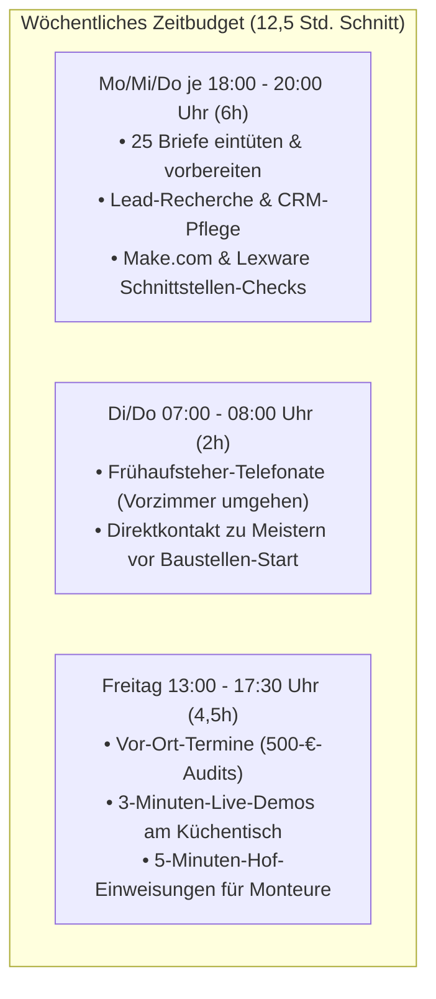
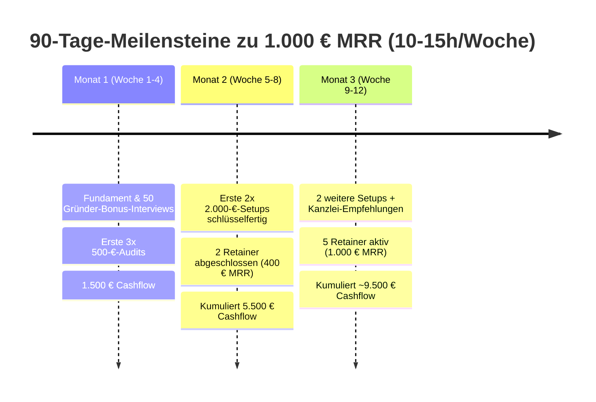
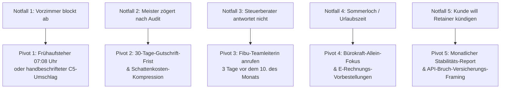

# MODUL 9: 90-Tage-Roadmap, KPI-Dashboard, Notfall-Pivots & Skalierungs-Ausblick

**Projekt:** KMU Service Harz (Variablen-Platzhalter für schnellen Rollout)  
**Inhaber & Ansprechpartner:** Robin Gornitzka | 38685 Langelsheim (Landkreis Goslar & Harz)  
**Kontakt:** `kontakt@kmu-service-harz.de` | `+49 (0) 151 / 123 456 78`  
**Fokus:** Realistische Nebenberufs-Roadmap (10–15 Std./Woche Zeiteinsatz) für die ersten 90 Tage, 1-Blick-Wochen-KPI-Scorecard, 5 praxiserprobte Notfall-Pivots & Pfad zu 5 festen Retainer-Kunden (1.000 € MRR + ~9.500 € Cashflow)  
**Status:** 100 % ausgearbeitet – sofort einsatzbereit (ohne Pilotprojekt-Abhängigkeit)

---

## 1. Strategischer Rahmen: Das Nebenberufs-Modell (10–15 Std./Woche)

### 1.1 Warum 10–15 Stunden pro Woche im Handwerker-Markt völlig ausreichen
Handwerksmeister sind morgens ab 06:45 Uhr vor der Baustelle oder freitags ab 13:00 Uhr auf dem Betriebshof erreichbar. Niemand im Handwerk erwartet, dass du montags um 11:00 Uhr erreichbar bist, während die Betriebe auf dem Dach oder im Rohbau stehen.

Mit einem fokussierten Zeitbudget von **10 bis 15 Stunden pro Woche** (z. B. 2 Stunden an 3 Abenden unter der Woche + 6 Stunden geblockt am Freitag/Samstag) lässt sich das System nebenberuflich mit maximaler Durchschlagskraft aufbauen:



### 1.2 Die 90-Tage-Zielmarke im Überblick
- **Wiederkehrende Einnahmen (MRR):** **1.000,00 € netto / Monat** (5 feste Kunden im 200-€-Retainer „Digitaler Hausmeister“).
- **Einmaliger Cashflow (kumuliert):** **ca. 9.500,00 € netto** (7x 500 € Audit = 3.500 € + 4x 1.500 € Setup-Restzahlung = 6.000 €).
- **Laufende Fixkosten:** **unter 55,00 € / Monat** (Founder OS 0 €, Make.com 9 €, OpenAI API ~5 €, Lexware Office ~19 €, Domain/Mail ~15 €).
- **Nettomarge:** **> 90 %** (Reiner Wissens- und Prozesswert ohne Wareneinsatz!).

---

## 2. Die 90-Tage-Roadmap (Woche für Woche im Detail)



---

### Phase 1: Monat 1 (Woche 1 bis 4) – Die Gründer-Bonus- & Pre-Launch-Offensive
*Hauptziel: 50 Betriebe kontaktiert, 10–12 Interviews geführt, 3x 500-€-Audit abgeschlossen, 1.500 € Sofort-Cashflow generiert.*

#### Woche 1 (Vorbereitung & Lead-Scouting – 12 Std.):
- [ ] **Technisches Setup:** Make.com Sandbox (`Mustermann Haustechnik Harz`) nach Anleitung aus Modul 8 anlegen, Test-Kassenbon im Auto deponieren, E-Rechnungs-Validator im Founder OS testen.
- [ ] **50-Adressen-Pipeline aufbauen:** 50 regionale Handwerksbetriebe (SHK, Elektro, Dach, Bau) in Langelsheim, Goslar (Baßgeige), Seesen, Bad Harzburg und Wernigerode nach den 4 Schwachstellen-Signalen (Modul 4) im CRM erfassen.
- [ ] **Druckmaterial vorbereiten:** 25x Tisch-One-Pager (Modul 8) und 50x Gründer-Bonus-Briefe (Modul 3) ausdrucken.

#### Woche 2 (Outreach Start – 13 Std.):
- [ ] **Versand Welle 1:** 25 personalisierte „Gründer-Ratgeber-Briefe“ mit gelbem Post-It (Modul 3) frankieren und einwerfen.
- [ ] **Erste Telefon-Kontakte:** 15 Telefonate (Frühaufsteher-Slot 07:08 Uhr oder Freitag 13:15 Uhr) führen nach dem Verbündeten-Skript (Modul 3).
- [ ] **Gewerbegebiet-Walk-in:** Freitagmittag 1,5 Stunden durch das Gewerbegebiet Langelsheim/Goslar spazieren und 5 C5-Umschläge persönlich am Empfang abgeben.

#### Woche 3 (Interviews & Diagnose – 14 Std.):
- [ ] **6–8 Gründer-Interviews führen:** Entweder telefonisch (15 Min.) oder kurz auf dem Betriebshof. Die 7 Diagnose-Fragen (Modul 3) stellen, Schmerzpunkt (32 Std./Monat) quantifizieren.
- [ ] **Audit-Pitch:** Den ersten beiden Meistern am Ende des Interviews das *„Praxis-Partner-Vorzugsticket“* (Modul 3) mit der Doppelten Sicherheits-Garantie anbieten.
- [ ] **Versand Welle 2:** Weitere 25 Gründer-Bonus-Briefe versenden.

#### Woche 4 (Gewerbe & Erste Abschlüsse – 14 Std.):
- [ ] **Meilenstein Gewerbe:** Gewerbeanmeldung bei der Stadt Langelsheim formal einreichen (ELSTER-Fragebogen zur steuerlichen Erfassung ausfüllen, Kleinunternehmerregelung wählen oder direkt Regelbesteuerung für Vorsteuerabzug).
- [ ] **3 Vor-Ort-Audits durchführen:** 3x 90 Minuten Vor-Ort-Potenzial-Audit (Modul 8) durchführen. 3-Minuten-Live-Demo mit dem Kassenbon vorführen, Schattenkosten berechnen.
- [ ] **Cashflow-Ergebnis Monat 1:** 3x 500 € Audit-Rechnung stellen = **1.500,00 € Netto-Cashflow** auf dem Geschäftskonto!

---

### Phase 2: Monat 2 (Woche 5 bis 8) – Der Setup-Motor & erste 3 Retainer
*Hauptziel: 2x 2.000-€-Standard-Setup umsetzen, erste 2 Retainer (400 € MRR) festigen, reguläre Post-Kadenz etablieren.*

#### Woche 5 (Start der ersten beiden Setups – 15 Std.):
- [ ] **Wandlung Stufe 2:** Die beiden begeistertsten Audit-Kunden unterschreiben die Freigabe für das schlüsselfertige 2.000-€-Setup (abzgl. 500 € Gutschrift = **je 1.500 € Restzahlung**; 50 % Anzahlung = 2x 750 € = **1.500 € Sofort-Zufluss**).
- [ ] **Tag 1–3 Fundament:** Zentrales Rechnungspostfach einrichten, 8-Sekunden-Smartphone-Belegweg für die Monteure aufschalten.

#### Woche 6 (Brücke & Kanzlei-Kopplung – 14 Std.):
- [ ] **Tag 4–7 Automatisierung:** Make.com Middleware koppeln, automatische PDF-Benennung und Baustellen-Ordnerablage aktivieren.
- [ ] **Tag 8–11 DATEV-Kopplung:** Lexware Office Sandbox mit DATEV Rechnungsdatenservice 1.0 (RDS 1.0) der Kanzlei des Meisters verbinden.
- [ ] **Outbound-Fortführung:** Jeden Dienstagabend 15 reguläre Handwerker-Briefe (Modul 4) versenden.

#### Woche 7 (Übergabe & Monteur-Rollout – 13 Std.):
- [ ] **Tag 12 Hof-Einweisung:** Freitagmorgen 07:00 Uhr 5-Minuten-Hof-Einweisung (Modul 8) vor den Gesellen durchführen. Laminierte A5-Bulli-Karten ins Handschuhfach legen.
- [ ] **GoBD-Übergabe & Restzahlung:** GoBD-Verfahrensdokumentation übergeben, Abnahmeprotokoll unterzeichnen lassen, Restzahlung (2x 750 € = **1.500 €**) abrufen.
- [ ] **Nahtlose Wandlung in Stufe 3:** Beide Kunden unterzeichnen den Wartungsvertrag „Digitaler Hausmeister“ (200 €/Monat netto mit 6 Monaten Mindestlaufzeit) = **400,00 € MRR aktiviert!**

#### Woche 8 (Pipeline-Nachschub – 12 Std.):
- [ ] **Telefon-Nachfass:** Empfänger der Postbriefe aus Woche 6 anrufen.
- [ ] **2 neue Audits terminieren & durchführen:** 2x 500 € = **1.000,00 € Cashflow**.
- [ ] **Zwischenstand Tag 60:** **5.500 € kumulierter Cashflow + 400 € fester MRR**.

---

### Phase 3: Monat 3 (Woche 9 bis 12) – Multiplikatoren & Festigung des 1.000-€-MRR-Plateaus
*Hauptziel: 2 weitere Setups umsetzen, Kanzlei-Empfehlungen aktivieren, 5 feste Retainer-Kunden erreichen = 1.000 € MRR.*

#### Woche 9 (Steuerberater-Infiltration – 12 Std.):
- [ ] **Kanzlei-Türöffner versenden:** Die Steuerberater der ersten beiden erfolgreichen Setup-Kunden anrufen (*„Wir haben für Ihren Mandanten [Meister Müller] die DATEV RDS 1.0 Schnittstelle eingerichtet – die Belege kommen ab sofort am 1. des Monats fertig vorkontiert rein“*).
- [ ] **„3 Sorgenkinder“-Brief:** An 5 ausgewählte Kanzleien in Goslar, Bad Harzburg und Wernigerode versenden (Modul 5).

#### Woche 10 (Setups 3 & 4 umsetzen – 15 Std.):
- [ ] **Setup-Start bei 2 weiteren Betrieben:** 2x 1.500 € Restsumme = **3.000,00 € Cashflow**.
- [ ] **1. Kanzlei-Gespräch führen:** 15-Minuten Kurzpräsentation (Modul 5 Deck) mit einer Fibu-Teamleiterin führen und 10 ausdruckbare Mandanten-Flyer (`KANZLEI-HARZ-GOBD`) übergeben.

#### Woche 11 (Rollout & Retainer-Abschluss – 13 Std.):
- [ ] **Übergabe Setups 3 & 4:** Hof-Einweisung bei Betrieb 3 und 4 durchführen. Beide Betriebe in den 200-€-Retainer wandeln (+ 400 € MRR = **800 € MRR gesamt**).
- [ ] **1 Kanzlei-Mandanten-Audit:** Erster Handwerker meldet sich über den Kanzlei-Flyer. 500-€-Audit durchführen (+ **500 € Cashflow**).

#### Woche 12 (Die 1.000-€-MRR-Ziellinie – 12 Std.):
- [ ] **5. Retainer abschließen:** Kanzlei-Mandant beauftragt direkt das Standard-Setup und bucht den Retainer dazu = **1.000,00 € MRR erreicht!**
- [ ] **Quartals-Review im Founder OS:** System auf Stabilität prüfen, 15-Minuten-Health-Check-Crons kontrollieren.
- [ ] **Gesamtergebnis Tag 90:** **ca. 9.500 € Cashflow erwirtschaftet + 1.000 € monatlich planbarer, automatisierter MRR bei 10–15h/Woche!**

---

## 3. Das 1-Blick-KPI-Dashboard (Wöchentliche 15-Minuten-Scorecard)

Jeden Freitagnachmittag um 17:00 Uhr nimmst du dir **exakt 15 Minuten Zeit**, um deine Zahlen im Founder OS einzutragen. Wir unterscheiden strikt zwischen **Input-KPIs** (Aktivitäten, die du zu 100 % selbst kontrollierst) und **Output-KPIs** (Ergebnisse, die automatisch folgen):

```text
================================================================================
KMU SERVICE HARZ – WÖCHENTLICHE 15-MINUTEN-SCORECARD (FREITAGS-CHECK)
================================================================================
Kalenderwoche: KW ___ | Datum: ___________ | Zeiteinsatz diese Woche: ___ Std.

--------------------------------------------------------------------------------
TEIL 1: INPUT-KPIS (DEINE AKTIVITÄTEN – 100 % IN DEINER HAND)
--------------------------------------------------------------------------------
| Kennzahl / Aktivität                     | Wochensoll (10-15h) | Ist diese Woche | Status |
|------------------------------------------|---------------------|-----------------|--------|
| 1. Physische Briefe versendet            | 15 Briefe           | _____ Briefe    | [ ] OK |
| 2. Kalt- & Nachfass-Anrufe gewählt       | 20 Anrufe           | _____ Anrufe    | [ ] OK |
| 3. Erreichte Entscheider (Meister/Büro)  | 6–8 Gespräche       | _____ Gespräche | [ ] OK |
| 4. Persönliche Vor-Ort Walk-ins (Höfe)   | 2–3 Betriebe        | _____ Betriebe  | [ ] OK |
| 5. Multiplikatoren-Kontakte (StB/Innung) | 1 Kontakt           | _____ Kontakte  | [ ] OK |

--------------------------------------------------------------------------------
TEIL 2: OUTPUT-KPIS (DEINE PIPELINE & ERGEBNISSE)
--------------------------------------------------------------------------------
| Kennzahl / Ergebnis                      | Monatssoll (Schnitt)| Ist dieser Monat| Status |
|------------------------------------------|---------------------|-----------------|--------|
| A. Gebuchte 500-€-Audits                 | 2–3 Audits / Monat  | _____ Audits    | [ ] OK |
| B. Durchgeführte Audits                  | 2–3 Audits / Monat  | _____ Audits    | [ ] OK |
| C. Wandlung in Stufe 2 (Setup 2.000 €)   | 1–2 Setups / Monat  | _____ Setups    | [ ] OK |
| D. Wandlung in Stufe 3 (200-€-Retainer)  | 80 % aller Setups   | _____ % Quote   | [ ] OK |
| E. Aktive Retainer-Kunden Gesamt (MRR)   | +1 bis +2 / Monat   | _____ Kunden    | [ ] OK |

--------------------------------------------------------------------------------
TEIL 3: FINANCIALS & CASHFLOW
--------------------------------------------------------------------------------
• Cashflow diese Woche vereinnahmt:               ___________ € netto
• Fester MRR zum Monatsende:                      ___________ € / Monat
• Monatliche Fixkosten (Tool-Stack):              ca. 48,00 € / Monat
• Reingewinn-Marge:                               > 90 %
================================================================================
```

---

## 4. Der Notfall-Pivot-Katalog (5 Krisen-Szenarien & Gegenmaßnahmen)

Wenn im Vertrieb eine Taktik hakt, verfallen wir nicht in Panik, sondern greifen sofort in unseren **standardisierten Notfall-Kasten**:



---

### Notfall 1: Das Vorzimmer blockt jeden Anruf ab
*Symptom: Die Bürokraft sagt reflexartig: „Der Chef hat keine Zeit, schicken Sie eine E-Mail an info@firma.de“.*

- **Ursache:** Die Bürokraft hält dich für einen lästigen Software-Verkäufer, der ihr noch mehr Arbeit aufhalsen will.
- **Sofort-Gegenmaßnahme (Der 3-Wege-Bypass):**
  1. **Der Frühaufsteher-Angriff (07:08 Uhr):** Ruf morgens zwischen 07:00 und 07:15 Uhr an. Zu dieser Zeit ist die Vorzimmerkraft noch gar nicht im Haus; der Meister selbst nimmt mit öligen Fingern in der Werkstatt das Telefon ab.
  2. **Der Verbündeten-Dreh:** Sag sofort: *„Frau [Name], ich rufe eigentlich wegen Ihnen an. Wie viele Stunden sitzen Sie freitags daran, zerknitterte Tankbons aus den Firmenwagen nachzutippen? Genau diesen Nervkram schaffen wir ab.“* (Verwandelt die Wächterin in deine stärkste Fürsprecherin).
  3. **Der haptische C5-Umschlag-Einwurf:** Fahr freitags kurz vorbei, wirf den handbeschrifteten Umschlag mit der Bulli-Karte (Modul 7) direkt in den Briefkasten oder gib ihn mit den Worten ab: *„Guten Tag, das ist die Prozess-Karte für Herrn [Meister] gegen das Zettelchaos im Bulli. Schönen Feierabend!“*

---

### Notfall 2: Meister zögert nach dem 500-€-Audit mit dem 2.000-€-Setup
*Symptom: Das Audit war super, der Meister lobt die Analyse, sagt aber: „Ich muss da noch mal drüber schlafen / melde mich nächsten Monat“.*

- **Ursache:** Er hat das Gefühl, das Problem verstanden zu haben, scheut aber die operative Entscheidung zur Umsetzung.
- **Sofort-Gegenmaßnahme (Der 30-Tage-Ablauf-Anker & Schattenkosten-Beweis):**
  - **Der 7-Tage-Nachfass-Anruf (Wort für Wort):**
    > *„Moin Herr [Meister], Robin Gornitzka hier. Ich rufe kurz an wegen der 500 € Audit-Gutschrift: Die 100 % Anrechnung auf das Setup ist ja an das 30-Tage-Fenster gebunden. Wenn wir nächste Woche starten, bezahlt sich das System bis Woche 8 komplett von selbst und Sie haben ab übernächstem Monat Ruhe. Wenn wir warten, verbrennt Ihr Betrieb laut unserem Messprotokoll jeden Monat weiterhin 900 € an unbezahlten Bürostunden – das ist in zwei Monaten mehr Verlust als das gesamte Setup kostet. Wollen wir nächsten Montag mit dem Belegeingang starten?“*

---

### Notfall 3: Steuerberatungskanzleien reagieren träge oder melden sich nicht
*Symptom: Der Kanzlei-Inhaber beantwortet deinen Brief nicht oder ist „monatelang in Terminen“.*

- **Ursache:** Kanzlei-Inhaber ertrinken in Steuerberatung und haben keine Zeit für strategische Post.
- **Sofort-Gegenmaßnahme (Die Fibu-Teamleiterin-Infiltration):**
  - Rufe nicht den Kanzlei-Chef an, sondern verlange die **Leiterin der Finanzbuchhaltung**:
    > *„Guten Tag, verbinden Sie mich bitte kurz mit Ihrer Fibu-Teamleitung bezüglich der DATEV RDS 1.0 Belegbereitstellung für Ihre Handwerks-Mandanten.“*
  - **Der 48-Stunden-Fibu-Hebel:** Rufe gezielt am **7. oder 8. des Monats** an (wenn die Fibu-Kräfte gerade im Beleg-Chaos vor der USt-Voranmeldung am 10. versinken):
    > *„Frau [Fibu-Leiterin], wie viele Ihrer Handwerker bringen Ihnen die Belege heute noch im Schuhkarton? Wir richten den Betrieben vor Ort den DATEV Rechnungsdatenservice 1.0 ein, damit Sie die Belege ab dem nächsten Monat am 1. digital und vorkontiert auf dem Tisch haben – ohne dass Ihre Kanzlei IT-Support leisten muss. Darf ich Ihnen unseren 1-seitigen Kanzlei-Leitfaden senden?“*

---

### Notfall 4: Das typische Handwerker-Sommerloch (Urlaubs- & Hochbauphase)
*Symptom: Im Juli/August sind alle Meister auf Großbaustellen oder 3 Wochen im Urlaub. Akquise am Telefon stockt.*

- **Ursache:** Saisonaler Rhythmus im Handwerk.
- **Sofort-Gegenmaßnahme (Der 2-Phasen-Sommer-Pivot):**
  1. **Fokus auf die im Büro verbleibende Bürokraft:** Während der Meister auf der Baustelle schwitzt, sitzt die Bürokraft oft allein im ruhigen Büro und hat Zeit für ein 20-minütiges Gespräch. Bereite mit ihr das Setup vor, sodass der Meister bei Urlaubsrückkehr nur noch unterschreiben muss.
  2. **E-Rechnungs-Vorbestellungs-Kampagne für den Herbst:** Schalte hyper-lokale Anzeigen oder versende Briefe mit dem harten Aufhänger:  
     *„Achtung Handwerk: Wer die E-Rechnung erst im Dezember anpackt, steht am 1. Januar still. Wir reservieren im Sommer 5 freie Umsetzungs-Plätze für den Oktober/November.“*

---

### Notfall 5: Retainer-Kündigungsschutz („Läuft doch alles, wozu noch 200 € zahlen?“)
*Symptom: Ein Kunde ruft nach 5 Monaten an und sagt: „Herr Gornitzka, das System läuft seit Monaten absolut stabil. Wir brauchen die monatliche Wartung eigentlich nicht mehr“.*

- **Ursache:** Das System läuft *zu lautlos*. Der Kunde vergisst, dass im Hintergrund kontinuierlich Schnittstellen überwacht werden.
- **Sofort-Gegenmaßnahme (Der monatliche „Erfolgs- & Stabilitäts-Report“ + Versicherungs-Framing):**
  1. **Proaktiver monatlicher 1-Seiter (Automatisch per Mail am Monatsende):**
     *„Ihr digitaler Monatsbericht Oktober 2026: 348 Belege in durchschnittlich 6,8 Sekunden fehlerfrei verarbeitet. 0 Schnittstellen-Abbrüche. Geschätzte gerettete Bürozeit: 15,5 Stunden. Ihr Schnittstellen-Wächter war 720 Stunden aktiv.“*
  2. **Das Airbag- & Versicherungs-Argument:**
     > *„Herr [Meister], dass alles so reibungslos läuft, liegt an unserem 15-Minuten-Monitoring. Cloud-Anbieter wie DATEV, Lexware oder Meta ändern monatlich ihre Sicherheits-Zertifikate und APIs. Ohne unsere laufende Wartung bricht der Belegfluss beim nächsten Update unbemerkt ab – und wenn der Fehler erst beim Quartalsabschluss auffällt, steht die Buchhaltung still und ein Notfall-IT-Einsatz kostet schnell 1.500 €. Der 200-€-Retainer ist die Vollkasko-Versicherung für Ihr freies Wochenende.“*

---

## 5. Skalierungs-Ausblick: Der Übergang in Vollzeit & erste Assistenz

Wann ist der richtige Zeitpunkt, das Nebenberufs-Modell auszubauen? Hier ist dein **eiserner Meilenstein-Kompass**:

| Meilenstein | MRR & Kunden | Monatlicher Cashflow | Strategischer nächster Schritt |
|---|---|---|---|
| **Stufe 1 (Ziel Monat 3)** | **1.000 € MRR** (5 Retainer-Kunden) | **~3.000 € bis 4.000 € / M.** | **Stabiles Nebenberufs-Fundament:** Alle Prozesse laufen sicher. Feste wöchentliche 12-Stunden-Routine etabliert. |
| **Stufe 2 (Monat 4–6)** | **2.000 € MRR** (10 Retainer-Kunden) | **~5.500 € bis 7.000 € / M.** | **Erste 520-€-Minijob-Assistenz einstellen:** Für Adress-Recherche, Briefe eintüten und Lead-Vorqualifizierung (gewinnt dir 4–5 Std./Woche zurück). |
| **Stufe 3 (Monat 6–9)** | **3.000 € MRR** (15 Retainer-Kunden) | **~8.000 € bis 10.000 € / M.** | **Der sichere Sprung in Vollzeit:** Dein fixer MRR (3.000 €) deckt bereits alle privaten Lebenshaltungskosten und Firmenkosten zu 100 % ab! Jeder Setup-Auftrag ist reiner Gewinn. |
| **Stufe 4 (Monat 12+)** | **5.000 €+ MRR** (25+ Kunden) | **15.000 €+ / Monat** | **Lokaler Marktführer im Harz:** Feste Partnerschaften mit 10+ Steuerkanzleien; Erweiterung auf ERP-Großprojekte ab 6.000 € mit Landesförderung in Sachsen-Anhalt. |

---

## 6. Gesamtfazit des 9-teiligen Marketing-Masterplans

Mit dem Abschluss von **Modul 9** verfügt **KMU Service Harz** über ein **lückenloses, praxiserprobtes und rechtssicheres Gesamtsystem**, das in der deutschen Agentur- und B2B-Landschaft seinesgleichen sucht:

1. **Messerscharfe Positionierung (Modul 1):** „Schluss mit dem Büro-Wochenende“ trifft den emotionalen Nerv von Meister und Bürokraft ohne jedes IT-Fachchinesisch.
2. **Konvertierende Website & lokale Dominanz (Modul 2):** DSGVO-konform, cookielos, mit interaktivem Rechner und GEO-optimiertem Schema.org für Google Maps Platz 1.
3. **Risikofreier Start (Modul 3):** 50 Gründer-Bonus-Interviews öffnen jede Tür vor der Gewerbeanmeldung.
4. **Verlässliche Outbound-Engine (Modul 4):** 2-Blatt-Handwerker-Brief + 11-Spalten-Pipeline für stetigen Neukundenzufluss.
5. **Kostenlose Multiplikatoren (Modul 5):** Steuerberater, Innungen und Großhändler empfehlen dich als Problemlöser.
6. **95 % Faceless Content (Modul 6):** Werkbank-POV und Bildschirm-Demos ohne Zwang vor die Kamera.
7. **0-€-Guerilla & High-Intent Ads (Modul 7):** Bulli-Karten im Handschuhfach und Google Ads mit 45 Negativ-Keywords.
8. **Unwiderstehliche Vor-Ort-Assets (Modul 8):** Die Musterbetrieb-Sandbox überzeugt in 3 Minuten am Küchentisch; das Altgesellen-Paket schaltet jede Mitarbeiter-Angst aus.
9. **Klarer 90-Tage-Fahrplan (Modul 9):** Schritt für Schritt vom ersten Tag zu 1.000 € planbarem MRR und freier Zeiteinteilung.

**Alles steht bereit. Es gibt keine offenen Ausreden mehr – jetzt geht es an die Umsetzung auf den Harzer Betriebshöfen!**
