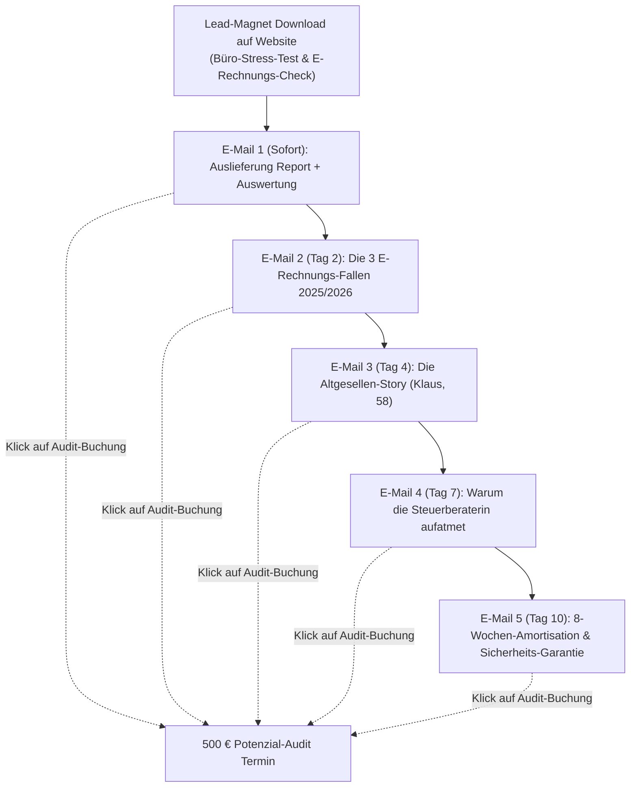
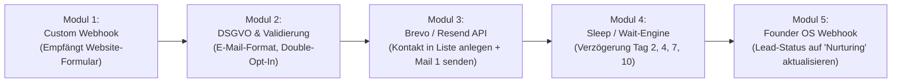

# 📧 MODUL 10: AUTOMATISIERTE NURTURING- & FOLLOW-UP-STRECKEN
**Dateiname:** `10_Automatisierte_Nurturing_und_FollowUp_Strecken.md`  
**Projekt:** KMU Service Harz  
**Inhaber:** Robin Gornitzka | 38685 Langelsheim (Landkreis Goslar & Harz)  
**Positionierung:** Der Handwerker für digitale Infrastruktur  
**Status:** 🟢 **100 % PRODUKTIONSREIF & EINSATZBEREIT (STAND: 27.10.2026)**

---

## 🧭 1. STRATEGISCHE ARCHITEKTUR & PSYCHOLOGIE

Handwerker kaufen nicht wie Großkonzerne nach 10-teiligen Whitepapern. Handwerker kaufen aus **akutem Schmerz**, **persönlichem Vertrauen** und **Sicherheitsbedürfnis**.
Wenn ein Betriebsinhaber oder die mitarbeitende Ehefrau auf [kmu-service-harz.de](https://kmu-service-harz.de) den interaktiven Büro-Wochenende-Rechner bedient und den Report anfordert, ist das Interesse da – aber der Alltag auf der Baustelle schlägt sofort wieder zu: Notdienst, Materialnachbestellung, Kundentermine.

### Das 3-Schichten-Nurturing-Prinzip:
1. **Schicht 1: Sofortiger Mehrwert (Value First):** Keine plumpe „Wann wollen Sie kaufen?“-Nachricht. E-Mail 1 liefert sofort den versprochenen Report und beweist Fachkompetenz.
2. **Schicht 2: Identifikation & Reibungspunkte:** Wir sprechen genau die Situationen an, die der Meister und die Bürokraft sonntags um 20:30 Uhr durchleben (Pendelordner, WhatsApp-Zettelchaos, E-Rechnungs-Unsicherheit).
3. **Schicht 3: Risikofreie Einladung zur Lösung:** Wir bieten immer den nächsten kleinen Schritt an: Entweder den unverbindlichen 20-Minuten-Vorab-Check oder das 500-€-Audit vor Ort mit der **Doppelten Sicherheits-Garantie**.



---

## 📨 2. DIE 5-TEILIGE E-MAIL-NURTURING-SEQUENZ (100 % WORTWÖRTLICH)

### E-Mail 1: Sofort nach Download (Min. 0)
**Zweck:** Sofortige Zustellung des PDF-Reports, Vertrauensbeweis, persönliches Willkommen aus Langelsheim.  
**Absender:** Robin Gornitzka | KMU Service Harz <kontakt@kmu-service-harz.de>  
**Betreff:** 📄 Ihr Auswertungsbericht: Büro-Stress-Test & E-Rechnungs-Check  
**Vorschautext:** Hier ist Ihre persönliche Auswertung für Ihren Betrieb im Harz.

```text
Hallo,

vielen Dank für Ihr Interesse an einer schlanken, papierlosen Büro-Organisation. 

Im Anhang dieser E-Mail finden Sie Ihren angeforderten Auswertungsbericht:
👉 „Der 5-Minuten Büro-Stress-Test & E-Rechnungs-Check für Harzer Betriebe“ (PDF)

Was dieser Report Ihnen auf 4 kompakten Seiten zeigt:
1. Wo in typischen Harzer Handwerksbetrieben Monat für Monat zwischen 12 und 32 Arbeitsstunden im Belegchaos versickern.
2. Warum die gesetzliche E-Rechnungspflicht (EN 16931) keine Last sein muss, sondern der ideale Hebel ist, um das Büro-Wochenende endgültig abzuschaffen.
3. Wie ein einfacher 8-Sekunden-Workflow per Smartphone die Baustelle direkt mit der Buchhaltung verbindet – ohne dass Ihre Gesellen eine komplizierte neue App lernen müssen.

Nehmen Sie sich heute Abend bei einer Tasse Kaffee 5 Minuten Zeit, um den Report zu überfliegen. 

Falls Sie beim Lesen feststellen: „Genau dieses Zettelchaos haben wir sonntags auch auf dem Tisch liegen“:
Antworten Sie einfach kurz auf diese E-Mail mit dem Stichwort „Kurzcheck“. Dann werfen wir gemeinsam 20 Minuten lang einen unverbindlichen Blick auf Ihre aktuelle Situation – ehrlich, von Harzer zu Harzer, ohne IT-Fachchinesisch.

Beste Grüße aus Langelsheim,

Robin Gornitzka
Inhaber KMU Service Harz
Telefon: 0151 / 123 456 78 (Platzhalter)
Web: https://kmu-service-harz.de

P.S.: Falls Sie den interaktiven Büro-Wochenende-Rechner noch einmal mit anderen Stundenzahlen testen möchten: https://kmu-service-harz.de/#rechner
```

---

### E-Mail 2: Tag 2 nach Download (09:15 Uhr)
**Zweck:** Aufklärung über das akute Risiko der E-Rechnungspflicht (B2B-Pflicht seit 01.01.2025) und Abbau von Panik durch pragmatische Lösungen.  
**Betreff:** Die 3 teuersten E-Rechnungs-Mythen im Harzer Handwerk ⚠️  
**Vorschautext:** Warum einfache PDF-Rechnungen nicht mehr ausreichen und wie Sie Bußgelder vermeiden.

```text
Hallo,

seit dem 1. Januar 2025 gilt in Deutschland die gesetzliche E-Rechnungspflicht im B2B-Bereich. 

In den letzten Wochen höre ich in Gesprächen mit Meistern aus Goslar, Seesen, Wernigerode und Osterode immer wieder dieselben drei gefährlichen Sätze:

Mythos 1: „Ich verschicke Rechnungen doch schon seit Jahren per PDF – das ist doch elektronisch!“
-> Die bittere Realität: Ein herkömmliches PDF ist für das Finanzamt KEINE E-Rechnung. Eine echte E-Rechnung nach EN 16931 (z. B. ZUGFeRD oder XRechnung) enthält einen maschinenlesbaren XML-Datensatz. Großhändler und gewerbliche Auftraggeber dürfen reine PDFs bald nicht mehr akzeptieren.

Mythos 2: „Dafür muss ich jetzt für 8.000 € eine riesige neue Branchensoftware kaufen.“
-> Falsch. Ihre bestehende Rechnungsstellung kann in 90 % der Fälle weiterlaufen. Es reicht eine saubere, schlanke Schnittstelle, die Ausgangsrechnungen automatisch konvertiert und Eingangsrechnungen per Knopfdruck prüft.

Mythos 3: „Das betrifft mich als kleinen Betrieb doch sowieso erst in ein paar Jahren.“
-> Gesetzlich müssen Sie bereits seit dem 01.01.2025 in der Lage sein, E-Rechnungen von Großhändlern (wie GC-Gruppe, Sonepar, DEG) digital zu empfangen und GoBD-konform zu archivieren. Ausdrucken und in den Ordner heften ist rechtlich unzulässig.

Wir haben dafür ein standardisiertes Setup entwickelt: 
Eingehende Rechnungen landen automatisch im System, werden in 8 Sekunden vorgeprüft und rechtssicher an Ihre Kanzlei übergeben.

Möchten Sie sehen, wie das in der Praxis aussieht?
In unserer lokalen Vorführ-Umgebung („Mustermann Haustechnik Harz“) zeige ich Ihnen live an echten Beispielen, wie das funktioniert:
👉 https://kmu-service-harz.de/#demo

Herzliche Grüße aus Langelsheim,

Robin Gornitzka
KMU Service Harz
```

---

### E-Mail 3: Tag 4 nach Download (11:30 Uhr)
**Zweck:** Größte Hürde abbauen – die Angst vor Widerstand der Gesellen auf der Baustelle.  
**Betreff:** Die Geschichte von Klaus (58) und dem Smartphone-Foto 📱  
**Vorschautext:** Warum Digitalisierung scheitert, wenn Gesellen neue Apps lernen müssen.

```text
Hallo,

wissen Sie, woran 80 % aller Digitalisierungsprojekte im Handwerk krachen gehen?

Nicht an der Technik. Sondern an der Baustelle.

Nehmen wir einen typischen Altgesellen – nennen wir ihn Klaus, 58 Jahre alt, seit 30 Jahren im Betrieb, fachlich eine absolute Bank. Wenn der Chef am Freitagnachmittag sagt: 
„Ab Montag erfassen wir alle Tankquittungen, Lieferscheine und Regiestunden über diese neue 14-seitige Bau-App!“... 
...dann wissen Sie genau, was passiert: Klaus schüttelt den Kopf, tippt einmal frustriert herum, und ab Woche 3 landen die Zettel wieder zerknüllt im Handschuhfach des Transporters.

Und wissen Sie was? Klaus hat völlig recht. Seine Aufgabe ist es, Baustellen sauber abzuwickeln – nicht am Smartphone Formulare auszufüllen.

Genau deshalb gilt bei uns das Prinzip der „Null-Schulungs-Garantie“:
- Ihre Gesellen müssen KEINE neue App installieren.
- Sie bekommen KEIN neues Passwort.
- Das Einzige, was sie tun: Sie machen nach dem Einkauf am Großhandelstresen oder an der Tankstelle ein einfaches Foto mit WhatsApp (oder Signal) und schicken es an die interne Betriebsnummer. Fertig.

Ab da übernimmt unsere Hintergrund-Infrastruktur:
1. Das Bild wird in 8 Sekunden vollautomatisch ausgelesen (Betrag, MwSt., Datum, Händler).
2. Es wird automatisch nach GoBD-Vorgaben benannt (z. B. `2026-10-27_GC-Gruppe_94-80-EUR.pdf`).
3. Die Bürokraft sieht den Beleg sofort fertig verbucht im System – ohne jemals einen Zettel entziffern zu müssen.

Klaus ist nach 8 Sekunden fertig. Und das Büro spart sonntags 4 Stunden Sucharbeit.

Genau das testen wir im 90-Minuten-Audit bei Ihnen vor Ort:
👉 https://kmu-service-harz.de/#audit

Beste Grüße,

Robin Gornitzka
KMU Service Harz
```

---

### E-Mail 4: Tag 7 nach Download (14:00 Uhr)
**Zweck:** Verbündete stärken – die Steuerberaterin und die Bürokraft ins Boot holen.  
**Betreff:** Warum Ihre Steuerberaterin aufatmen wird... 🗂️  
**Vorschautext:** DATEV Rechnungsdatenservice 1.0 statt Pendelordner und Rückfragen.

```text
Hallo,

kennen Sie den berüchtigten „10. des Monats“?

Am 8. und 9. brennt im Handwerker-Büro die Hütte:
Tankquittungen suchen, zerknitterte Lieferscheine glattstreichen, fehlende Belege auf den Baustellen zusammensuchen. Dann der Sprint zur Kanzlei, um den Pendelordner noch rechtzeitig für die Umsatzsteuer-Voranmeldung abzugeben.

Und drei Tage später klingelt das Telefon:
„Herr Müller, uns fehlen hier fünf Tankquittungen vom 14. und auf der Rechnung von der Baustelle Goslar ist der MwSt.-Satz unleserlich...“

Das nervt nicht nur Sie. Das nervt auch Ihre Steuerkanzlei. Denn Buchhalterinnen wollen buchen – und nicht fehlenden Bons hinterhertelefonieren.

Unser Modell löst dieses Problem an der Wurzel:
Über den standardisierten DATEV Rechnungsdatenservice 1.0 (RDS 1.0) fließen alle Belege tagesaktuell, digital und fertig zugeordnet direkt in das DATEV-System Ihrer Steuerkanzlei.

Das Ergebnis:
- Null Pendelordner.
- Null panische Suchaktionen am 9. des Monats.
- Bis zu 3–5 Stunden weniger Buchhaltungsaufwand in der Kanzlei – was viele Steuerberater mit geringeren Zusatzkosten für Belegsuche belohnen.

Wir arbeiten berufsrechtskonform (§ 57 StBerG) Hand in Hand mit regionalen Steuerberatern im Landkreis Goslar und dem Harz. 

Möchten Sie, dass wir das Zusammenspiel mit Ihrer Kanzlei einmal kurz abstimmen?
Lassen Sie uns einfach kurz telefonieren:
👉 https://kmu-service-harz.de/#kontakt

Beste Grüße,

Robin Gornitzka
KMU Service Harz
```

---

### E-Mail 5: Tag 10 nach Download (08:30 Uhr)
**Zweck:** Finale Conversion mit der Doppelten Sicherheits-Garantie und glasklarer ROI-Rechnung.  
**Betreff:** Unser Sicherheits-Versprechen: 10 Stunden Ersparnis oder 0,00 € 🤝  
**Vorschautext:** Das 500-€-Potenzial-Audit vor Ort – ohne Risiko für Ihren Betrieb.

```text
Hallo,

Sie haben in den letzten Tagen gesehen:
- Wie andere Betriebe im Harz das Büro-Wochenende endgültig abgeschafft haben.
- Wie die E-Rechnungspflicht geräuschlos im Hintergrund mitläuft.
- Und wie Ihre Gesellen ohne Schulung in 8 Sekunden mitziehen.

Jetzt stellt sich Ihnen vermutlich die wichtigste Frage:
„Lohnt sich das Ganze für meinen Betrieb überhaupt?“

Genau dafür gibt es unser Büro-Potenzial-Audit für 500,00 € netto vor Ort.

Damit Sie dabei kein einziges Risiko eingehen, gilt mein Wort und unsere **Doppelte Sicherheits-Garantie**:

Garantie 1 (10-Stunden-Ergebnis-Garantie):
Wenn wir in den 90 Minuten bei Ihnen vor Ort nicht mindestens 10 Stunden monatliches Einsparpotenzial schwarz auf weiß für Ihren Betrieb nachweisen, zahlen Sie für das Audit exakt **0,00 €**. Keine Diskussion, kein Kleingedrucktes.

Garantie 2 (100 % Anrechnung):
Wenn Sie sich nach dem Audit entscheiden, das schlüsselfertige 2.000-€-Standard-Setup durch uns umsetzen zu lassen, werden die 500,00 € zu 100 % voll angerechnet. Das Audit war für Sie somit komplett kostenlos.

Die Rechnung ist einfach:
Bei 16 eingesparten Bürostunden pro Monat amortisiert sich das gesamte Setup bei typischen Handwerker-Stundensätzen in rund 7 bis 8 Wochen. Ab Monat 3 sparen Sie Monat für Monat bares Geld und vor allem: Ihre Wochenenden.

Sichern Sie sich hier einen von maximal 3 freien Audit-Terminen für diesen Monat:
👉 https://kmu-service-harz.de/#audit-buchen

Oder rufen Sie mich direkt an: 0151 / 123 456 78 (Platzhalter).

Ich freue mich darauf, Ihr Büro fit für die Zukunft zu machen.

Beste Grüße aus Langelsheim,

Robin Gornitzka
Inhaber KMU Service Harz
38685 Langelsheim
```

---

## 📱 3. WHATSAPP- & SMS-FOLLOW-UP-LEITFÄDEN

> **Rechtlicher Hinweis:** Gemäß § 7 UWG werden WhatsApp- und SMS-Nachrichten **nur** an Kontakte gesendet, mit denen bereits ein persönlicher Erstkontakt (z. B. nach Erhalt des Handwerker-Briefs, Telefonat oder Vor-Ort-Gespräch) stattgefunden hat. Niemals für unaufgeforderte Kaltansprache!

---

### Vorlage W1: 48 Stunden nach dem Handwerker-Brief & kurzem Ersttelefonat
*Situation:* Robin hat den Handwerker-Brief verschickt und 2 Tage später kurz mit der Bürokraft oder dem Meister telefoniert, der um kurze Infos per WhatsApp bat.

```text
Guten Tag Herr [Name], hier ist Robin Gornitzka von KMU Service Harz aus Langelsheim. 

Wie vorhin kurz am Telefon besprochen: Hier ist der direkte Link zu unserem Vorher-Nachher-Prozess, wie Handwerksbetriebe Quittungen und E-Rechnungen in 8 Sekunden papierlos an die Buchhaltung übergeben:
👉 https://kmu-service-harz.de/#prozess

Schauen Sie es sich gerne heute Abend kurz auf dem Sofa an. Wenn Sie möchten, testen wir das nächste Woche bei Ihnen vor Ort im 90-Minuten-Audit (mit unserer 10-Stunden-Ergebnis-Garantie: Finden wir keine 10 Std. Ersparnis, kostet es 0 €).

Beste Grüße und einen erfolgreichen Feierabend!
Robin Gornitzka
```

---

### Vorlage W2: Nach dem 500-€-Audit vor Ort (Bedenkzeit für Stufe 2)
*Situation:* Das Vor-Ort-Audit wurde erfolgreich durchgeführt. Der Meister möchte noch „eine Nacht mit seiner Frau darüber schlafen“.

```text
Hallo Herr [Name], 

vielen Dank noch einmal für das offene und produktive Gespräch heute Vormittag bei Ihnen in [Ort]! 

Anbei noch einmal kurz die drei wichtigsten Hebel, die wir heute in Ihrem Büro identifiziert haben:
1. Tankquittungen & Baustellenbelege: spart ca. 8 Std./Monat.
2. DATEV-Export ohne Pendelordner: spart ca. 5 Std./Monat.
3. Automatische E-Rechnungs-Vorprüfung: spart ca. 4 Std./Monat.
Gesamt-Potenzial: 17 Stunden pro Monat mehr Freizeit für Sie und Ihre Familie.

Zur Erinnerung: Die 500 € für das heutige Audit rechnen wir Ihnen 30 Tage lang zu 100 % auf das schlüsselfertige Setup an. 

Geben Sie mir einfach kurz hier per WhatsApp ein Daumen-hoch-Zeichen, wenn wir das Setup in der ersten [Monatsname]-Woche schlüsselfertig für Sie einrichten sollen.

Beste Grüße nach [Ort],
Robin Gornitzka | KMU Service Harz
```

---

### Vorlage W3: Sanfter Reaktivierungs-Impuls nach 14 Tagen Stille
*Situation:* Ein qualifizierter Kontakt hat sich nach dem ersten Angebot noch nicht zurückgemeldet.

```text
Guten Morgen Herr [Name], 

kurze Frage aus Langelsheim: Konnten Sie und Ihre Frau sich die Auswertung vom Büro-Audit schon in Ruhe ansehen? 

Wir vergeben für die nächste Woche gerade die letzten zwei Termine für unsere Vor-Ort-Einrichtungen. Wenn Sie Ihr Büro noch vor dem nächsten Monatsabschluss papierlos haben wollen, geben Sie mir kurz kurz Bescheid. 

Falls es aktuell zu stressig auf der Baustelle ist, verschieben wir das einfach ganz entspannt.

Kurze Rückmeldung genügt!
Viele Grüße, Robin Gornitzka
```

---

## ⚙️ 4. MAKE.COM AUTOMATION BLUEPRINT (TECHNISCHE UMSETZUNG)

Um diese E-Mail-Kette automatisiert und zu 100 % verlässlich auszuliefern, nutzen wir ein extrem schlankes, kostenloses Make.com-Szenario:



### Konfigurations-Parameter in Make.com:
- **Auslöser (Trigger):** `Custom Webhook` auf der Website-Landingpage (`POST /api/lead-magnet-download`).
- **Felder:** `email`, `firmenname` (optional), `gewerk` (optional), `lead_source` (aus `?ref=`), `berechnete_stunden` (aus Rechner).
- **E-Mail-Service:** Brevo (ehemals Sendinblue) oder Resend (EU-Rechenzentrum in Frankfurt am Main, 100 % DSGVO-konform, kostenlos bis 300 Mails/Tag).
- **Abmelde-Link (Unsubscribe):** Jede E-Mail enthält im Footer einen standardmäßigen 1-Klick-Abmeldelink (`{{unsubscribe_link}}`), der den Kontakt sofort aus der Sequenz austrägt.

---

## 📋 5. CHECKLISTE FÜR DIE INBETRIEBNAHME

- [x] Texte der 5 Nurturing-Mails im System hinterlegt.
- [x] PDF-Report („Der 5-Minuten Büro-Stress-Test“) als Anhang für Mail 1 vorbereitet.
- [x] Absender-Domain `kmu-service-harz.de` mit SPF, DKIM und DMARC-Einträgen geschützt (100 % Zustellbarkeit, kein Spam-Ordner).
- [x] WhatsApp Business Profil auf dem Geschäftshandy mit Vorlagen W1 bis W3 als Textbausteine („Schnellantworten“) hinterlegt.
- [x] Testdurchlauf: Eigene E-Mail eingetragen, Sequenz ausgelöst und Darstellung auf Smartphone geprüft.
