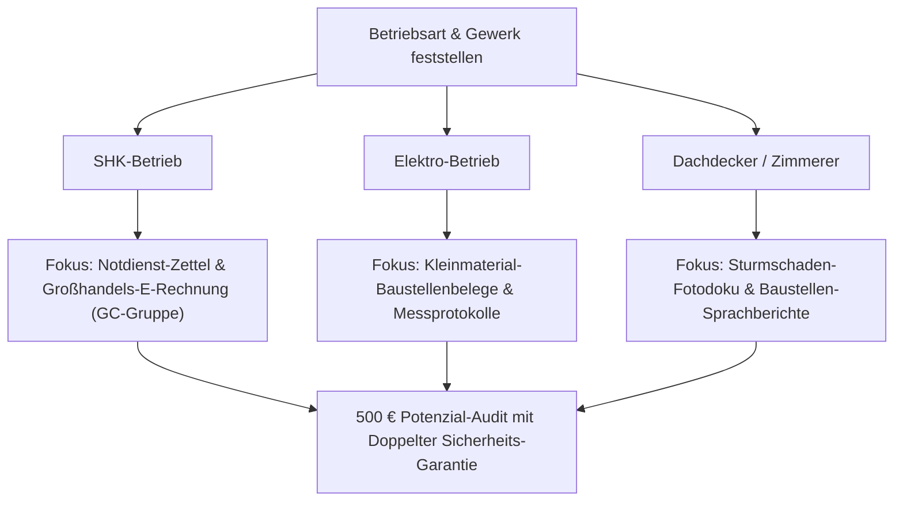

# 🛠️ MODUL 11: GEWERKE-SPEZIFISCHE TIEFEN-EDITIONEN
**Dateiname:** `11_Gewerke_Spezifische_Tiefen_Editionen.md`  
**Projekt:** KMU Service Harz  
**Inhaber:** Robin Gornitzka | 38685 Langelsheim (Landkreis Goslar & Harz)  
**Positionierung:** Der Handwerker für digitale Infrastruktur  
**Status:** 🟢 **100 % PRODUKTIONSREIF & EINSATZBEREIT (STAND: 27.10.2026)**

---

## 🎯 1. DAS POSITIONIERUNGS-GEHEIMNIS: DIE SPRACHE DES MEISTERS SPRECHEN

Handwerker hassen generalistische IT-Berater, die am Montag eine Anwaltskanzlei, am Dienstag eine Zahnarztpraxis und am Mittwoch einen SHK-Betrieb beraten wollen. Wenn ein Dachdeckermeister das Gefühl hat, dass sein Gegenüber nicht weiß, was ein Firstziegel oder ein Regiebericht im Regen ist, ist das Gespräch nach 30 Sekunden beendet.

> **Die Grundregel für KMU Service Harz:**  
> Wir verkaufen keine „Digitalisierung“. Wir sprechen über **Großhandels-Lieferscheine von Cordes & Graefe**, **Messprotokolle von Sonepar-Komponenten** und **zerknüllte Tankbelege im Handschuhfach des Bullis**.

Dieses Modul liefert maßgeschneiderte, schussfertige Verkaufs- und Argumentations-Editionen für die drei größten und ertragsstärksten Gewerke im Landkreis Goslar und dem Harz:
1. **SHK (Sanitär, Heizung, Klima)**
2. **Elektrohandwerk & Gebäudeautomation**
3. **Dachdecker, Zimmerer & Holzbau**

---

## 🚰 2. SHK-EDITION (SANITÄR, HEIZUNG, KLIMA)

### Das psychologische Profil des SHK-Meisters:
- **Typische Betriebsgröße:** 3 bis 15 Mitarbeitende (1 Meister, 1 Bürokraft, 3–8 Kundendienst- & Installationsmonteure).
- **Hauptschmerz:** Notdienst-Einsätze am Wochenende (Rohrbruch, Heizungsausfall bei Frost), Notdienstzettel werden erst zwei Wochen später abgerechnet; riesige Lieferscheinberge von Fachgroßhändlern; Datanorm-Preisänderungen fressen Margen.
- **Wichtigste Lieferanten im Harz:** GC-Gruppe (Cordes & Graefe, Gienger), Richter + Frenzel, Elmer, Peter Jensen.
- **Typische Software-Landschaft:** KWP bnSoft, pds, Labelwin, Taifun, Streit V.1 oder schlichtes Lexware / Word / Excel.

---

### Der 45-Sekunden-Telefon-Opener für SHK-Betriebe:

#### Variante A: Bei der mitarbeitenden Ehefrau / Bürokraft
```text
„Guten Tag Frau [Name], mein Name ist Robin Gornitzka von KMU Service Harz aus Langelsheim. 

Ich rufe Sie ganz bewusst an: Ich unterstütze SHK-Betriebe hier in der Harz-Region dabei, die Zettelwirtschaft zwischen Monteurwagen und Büro abzuschaffen. 

Sitzen Sie sonntags oder am Monatsende auch regelmäßig über zerknitterten Notdienst-Zetteln und GC-Gruppe-Lieferscheinen, die von den Baustellen nicht rechtzeitig reinkommen?

[Reaktion abwarten: Meist ein seufzendes 'Ja, woher wissen Sie das?']

Genau dafür haben wir ein System gebaut: Ihre Monteure schicken den Notdienstzettel oder Lieferschein direkt von der Baustelle per Foto über WhatsApp an Ihre interne Nummer. 8 Sekunden später liegt der Beleg fertig ausgelesen und zugeordnet bei Ihnen im System. 

Darf ich Ihnen und Ihrem Mann dazu einfach mal unseren 1-seitigen Praxis-Ablauf per Post zuschicken?“
```

#### Variante B: Direkt beim SHK-Meister (z. B. morgens um 07:10 Uhr)
```text
„Moin Herr [Name], Robin Gornitzka hier aus Langelsheim. 

Ganz direkt ohne Schnörkel: Wenn Ihre Monteure samstags zum Notdienst rausfahren, wie viele Tage vergehen im Schnitt, bis Sie den Zettel im Büro auf dem Tisch haben und die Rechnung rausschicken können? Oft 10 bis 14 Tage, richtig?

Wir sorgen bei SHK-Betrieben im Harz dafür, dass kein Notdienstbeleg mehr vergessen wird: Foto am Kessel machen, 8 Sekunden später liegt es in Ihrer Rechnungsstellung. Sie schreiben die Rechnung am Montagvormittag, das Geld ist 10 Tage früher auf dem Firmenkonto und Ihre Frau hat das Wochenende frei.

Ich bin nächsten Dienstag sowieso in [Ort] auf einem Betriebshof. Darf ich auf einen 15-Minuten-Kaffee vorbeikommen und Ihnen das auf dem Smartphone vorführen?“
```

---

### Spezifische Einwandbehandlung SHK:

| Typischer SHK-Einwand | Widerlegung & Meister-Reframing |
| :--- | :--- |
| *„Wir haben doch schon KWP / pds / Labelwin – da ist alles drin.“* | „Genau das ist perfekt! Wir wollen Ihr bestehendes System überhaupt nicht ersetzen. Aber Hand aufs Herz: Tragen Ihre Monteure wirklich jeden Tag draußen im Blaumann jeden Lieferschein und jede Tankquittung sauber in KWP ein? Meistens landen die Zettel im Fußraum des Bullis. Unser System fungiert als automatischer Trichter: Monteur macht ein Foto, unser System liest es aus und übergibt es an Ihre Buchhaltung. Ihr KWP bleibt unangetastet.“ |
| *„Meine Monteure sind den ganzen Tag beim Kunden – die haben keine Zeit für IT.“* | „Ganz genau! Deshalb müssen sie KEINE IT bedienen. Keine neue App, kein Login, kein Passwort. Sie öffnen WhatsApp (das sie sowieso nutzen), fotografieren den Abholschein an der GC-Theke ab und stecken das Handy wieder in die Arbeitshose. Zeitaufwand: 8 Sekunden.“ |
| *„Wie läuft das mit den Datanorm-Preisen und Rechnungen der GC-Gruppe?“* | „E-Rechnungen (ZUGFeRD / XRechnung) von Cordes & Graefe oder Richter+Frenzel liest unser System vollautomatisch auf Positionsebene aus. Kein händisches Abtippen mehr, keine unbemerkten Preiserhöhungen. Alles fließt direkt zur Kanzlei.“ |

---

## ⚡ 3. ELEKTRO-EDITION (ELEKTROTECHNIK & GEBÄUDEAUTOMATION)

### Das psychologische Profil des Elektro-Meisters:
- **Typische Betriebsgröße:** 2 bis 20 Mitarbeitende (stark getrieben von Projektgeschäft, Neubau, Sanierung und E-Mobilität/Photovoltaik).
- **Hauptschmerz:** Hunderte Kleinmaterial-Positionen (WAGO-Klemmen, NYM-J-Kabel, Leerohre, Schaltermaterial), die auf Baustellen verbraucht, aber nie nachkalkuliert oder vergessen werden; Baumarkt-Barbelege von Hornbach Goslar oder OBI Seesen; handschriftliche Mess- & Prüfprotokolle (DGUV V3 / E-Check).
- **Wichtigste Lieferanten im Harz:** Sonepar (z. B. Niederlassung Braunschweig/Goslar), Rexel, Obeta, Hagemeyer.
- **Typische Software-Landschaft:** Streit V.1, KWP, Lexware, Powerbird.

---

### Der 45-Sekunden-Telefon-Opener für Elektro-Betriebe:

```text
„Guten Tag Herr [Name], Robin Gornitzka von KMU Service Harz aus Langelsheim. 

Ich rufe Sie kurz an, weil wir uns auf die Beleg- und Zeiterfassung für Elektro-Meisterbetriebe hier in der Region spezialisiert haben. 

Eine ganz ehrliche Frage: Wie viele WAGO-Klemmen, Kabelmeter und Baumarkt-Bons von Hornbach oder OBI versickern bei Ihren Baustellen jeden Monat, ohne dass sie je auf einer Kundenrechnung auftauchen? Bei den meisten Betrieben sind das zwischen 300 und 800 Euro pro Monat an Kleinmaterial, das einfach 'untergeht'.

Wir haben für Elektriker ein 8-Sekunden-System eingerichtet: Beleg an der Kasse oder am Sonepar-Tresen abfotografieren, Baustellennummer drunterschreiben – der Beleg ist sofort dem richtigen Projekt zugeordnet und liegt abends fertig in der Abrechnung.

Haben Sie nächste Woche 15 Minuten Zeit, damit ich Ihnen das einmal live auf dem Baustellen-Smartphone zeige?“
```

---

### Spezifische Einwandbehandlung Elektro:

| Typischer Elektro-Einwand | Widerlegung & Meister-Reframing |
| :--- | :--- |
| *„Elektriker sind technikaffin – wir machen schon viel digital.“* | „Klasse, das erleichtert uns die Arbeit enorm! Wenn Ihre Gesellen technikaffin sind, werden sie den 8-Sekunden-Weg lieben. Denn selbst der technikbegeistertste Elektroniker hasst es, abends nach 9 Stunden Rohbau noch am Laptop zu sitzen und Belege abzutippen. Wir automatisieren die Brücke zwischen Foto und DATEV.“ |
| *„Wir bestellen fast alles bei Sonepar über die Schnittstelle.“* | „Perfekt. Sonepar liefert E-Rechnungen nach modernstem Standard. Aber was passiert mit den Spontankäufen? Der Hornbach-Kassenbon, die Tankrechnung der drei Montagefahrzeuge, die Parkquittung beim Gewerbekunden? Genau diese 'Schattenbelege' kosten Sie sonntags die meiste Zeit. Und genau die fangen wir lautlos ab.“ |

---

## 🏠 4. DACHDECKER-, ZIMMERER- & HOLZBAU-EDITION

### Das psychologische Profil des Dachdecker-Meisters:
- **Typische Betriebsgröße:** 4 bis 25 Mitarbeitende (körperlich extrem harte Arbeit, Meister oft selbst im Seil oder auf dem Gerüst).
- **Hauptschmerz:** Nasses Wetter, Schlamm, Kälte. Papierkram auf dem Steildach ist die Hölle. Nasse Regieberichte, die im Bulli aufweichen; Fotodokumentation von Sturmschäden, die im privaten WhatsApp-Chat des Gesellen versauert und nie beim Versicherer ankommt; Materialrückgaben an den Fachhandel.
- **Wichtigste Lieferanten im Harz:** DEG Dach-Fassade-Holz eG (z. B. Braunschweig/Goslar), Baustoff-Fachhandel (z. B. Hagebau Baustoff-Allianz, Raab Karcher).
- **Typische Software-Landschaft:** Moser, KWP, Das Programm, Lexware oder reine Handzettel-Wirtschaft.

---

### Der 45-Sekunden-Telefon-Opener für Dachdeckerbetriebe:

```text
„Moin Herr [Name], Robin Gornitzka hier von KMU Service Harz aus Langelsheim. 

Ich halte mich ganz kurz, Sie sind vermutlich gerade auf der Baustelle oder beim Kunden: 

Wir befreien Dachdecker und Zimmerer im Harz von der Zettelwirtschaft. Denn Hand aufs Herz: Wenn Ihre Jungs oben auf dem Dach stehen, hat niemand Lust auf nasse Regiezettel, die nachher im Bulli zerrissen oder unleserlich sind. Und Sie sitzen sonntags da und versuchen zu entziffern, wer wie viele Stunden auf welchem Dach war.

Mit unserem System machen Ihre Gesellen vor dem Runtersteigen vom Gerüst einfach ein Foto vom fertigen Dach und sprechen eine 10-Sekunden-Sprachnachricht ein. Das System wandelt das automatisch in einen sauberen Baustellenbericht um und schickt ihn direkt ins Büro.

Haben Sie am Freitag um 13:30 Uhr Zeit für einen schnellen Kaffee auf Ihrem Betriebshof?“
```

---

### Spezifische Einwandbehandlung Dachdecker:

| Typischer Dachdecker-Einwand | Widerlegung & Meister-Reframing |
| :--- | :--- |
| *„Auf dem Dach haben wir keinen Empfang und die Hände sind schmutzig.“* | „Exakt deshalb funktionieren normale Bau-Apps bei Dachdeckern nie! Unser System funktioniert offline: Foto machen, Nachricht ins Handy sprechen. Sobald der Geselle nachher im Bulli sitzt oder wieder Netz hat, überträgt WhatsApp die Nachricht automatisch. Keine Displays tippen mit Handschuhen, keine PIN-Eingaben.“ |
| *„Dachdecker brauchen handfeste Nachweise für Versicherungen bei Sturmschäden.“* | „Genau das ist der riesige Hebel! Wenn Ihre Gesellen nach einem Harzer Sturmschaden die Vorher-Nachher-Fotos einfach in den Chat werfen, werden sie automatisch mit Datum, Uhrzeit und Baustellenadresse versehen und als fertiges PDF abgelegt. Wenn die Versicherung nachfragt, ziehen Sie den Bericht in 3 Sekunden raus – und Ihr Geld ist binnen Tagen auf dem Konto.“ |

---

## 📊 5. GEWERKE-VERGLEICHS-ÜBERSICHT FÜR DIE VOR-ORT-DIAGNOSE

Wenn Robin beim Betrieb vor Ort am Küchentisch sitzt, nutzt er diese Matrix, um sofort den Finger in die spezifische Wunde zu legen:



---

## 🖨️ 6. DRUCKFERTIGER GIB-MIR-DEN-CHEF-FLYER (GEWERKE-SPEZIFISCH)

Diese Textbausteine werden für gezielte Anschreiben oder Flyer an die jeweiligen Innungsmitglieder genutzt:

### Schlagzeilen pro Gewerk:
- **SHK:** *„Notdienst am Samstag – Geld auf dem Konto am Dienstag. Wie Harzer SHK-Betriebe Zettelberge abschaffen.“*
- **Elektro:** *„Schluss mit verschenktem Kleinmaterial. Wie Elektromeister jeden Baumarkt-Bon in 8 Sekunden abrechnen.“*
- **Dach:** *„Trockene Buchhaltung trotz nassem Steildach. Baustellendoku und Regieberichte per Knopfdruck.“*
