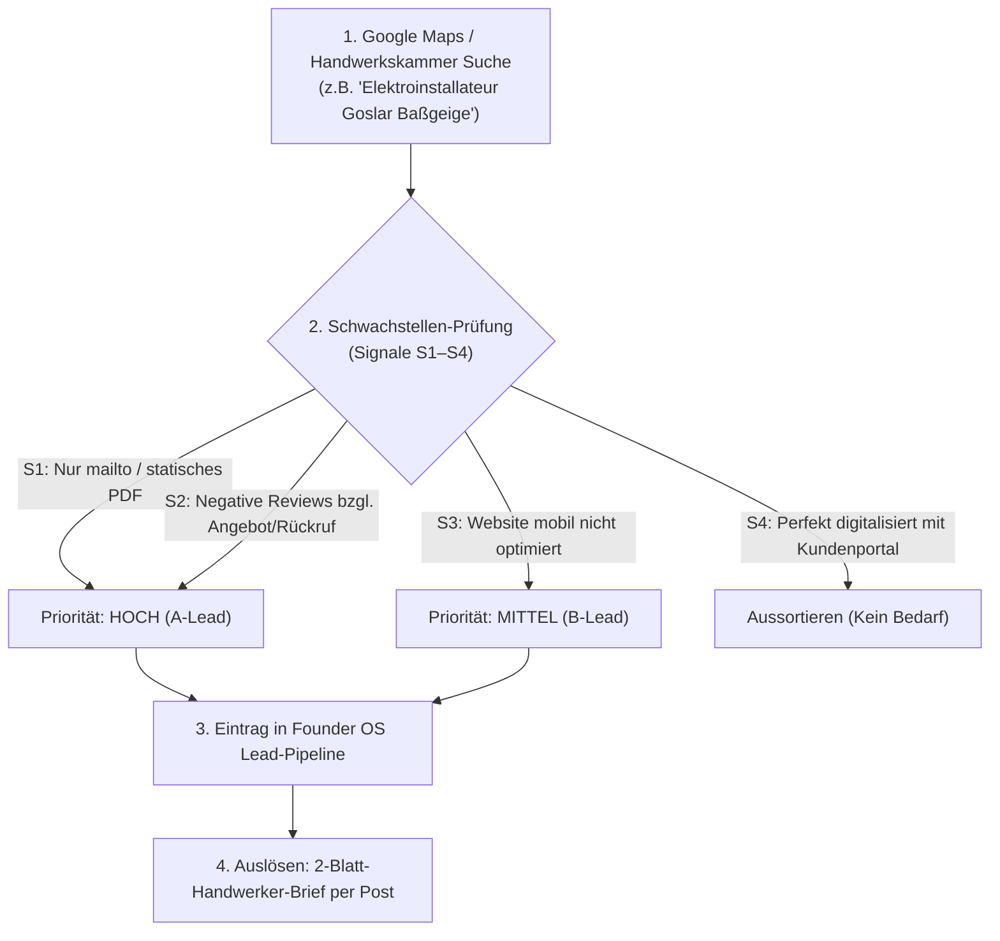

# 📦 MODUL 12: 50-BETRIEBE-RECHERCHE-PIPELINE & HAPTISCHE WILLKOMMENS-BOX
**Dateiname:** `12_50_Betriebe_Recherche_und_Willkommens_Box.md`  
**Projekt:** KMU Service Harz  
**Inhaber:** Robin Gornitzka | 38685 Langelsheim (Landkreis Goslar & Harz)  
**Positionierung:** Der Handwerker für digitale Infrastruktur  
**Status:** 🟢 **100 % PRODUKTIONSREIF & EINSATZBEREIT (STAND: 27.10.2026)**

---

## 🎯 1. STRATEGISCHER ZWECK DIESES MODULS

Vertriebserfolg im Handwerk scheitert fast nie an der Botschaft, sondern an zwei operativen Lücken:
1. **Vor dem Verkauf:** Unstrukturierte Kaltakquise ohne vorqualifizierte Adressen und klare Priorisierung.
2. **Nach dem Verkauf:** Ein „kühles“ Software-Setup, bei dem der Kunde sich nach Unterschrift alleine gelassen fühlt, Zweifel bekommt und den Retainer kündigt.

Dieses Modul schließt beide Lücken dauerhaft:
- **Teil A** liefert das schlüsselfertige Recherche- und CRM-Erfassungsraster für die ersten **50 echten Betriebe** im Landkreis Goslar und dem Harz.
- **Teil B** liefert das Konzept und die Einkaufsliste für die haptische **„Handschlag-Willkommens-Box“**, die Robin bei jedem Neukunden-Setup persönlich auf den Küchentisch stellt – für 0 % Kaufrücktritt und maximale Mundpropaganda.

---

## 🗺️ 2. TEIL A: DAS 50-BETRIEBE-RECHERCHE- & QUALIFIZIERUNGS-RASTER

### Die Gewerke- & Regional-Verteilung (Ziel-Mix für den Harz):
- **20x SHK-Betriebe (Sanitär, Heizung, Klima):** Höchster Notdienst- & Belegschmerz (Cordes & Graefe, Gienger).
- **15x Elektro-Betriebe (Elektroinstallation & Gebäudeautomation):** Hoher Kleinmaterial-Verlust (Sonepar, Rexel).
- **10x Dachdecker & Zimmereien:** Nasse Regieberichte, Sturm- und Baustellendokumentation.
- **5x Lokale Dienstleister / GaLaBau / Gebäudereinigung:** Hoher mobiler Beleg- und Quittungsdurchlauf.

### Regionale Verteilung (Kernradius 25 km um 38685 Langelsheim):
1. **Cluster 1 (Direktes Umfeld – 0 bis 10 km):** Langelsheim, Astfeld, Wolfshagen, Lautenthal, Seesen.
2. **Cluster 2 (Goslar & Baßgeige – 10 bis 15 km):** Gewerbegebiet Goslar-Baßgeige, Oker, Hahndorf, Vienenburg.
3. **Cluster 3 (Süd-/Ostharz & Kurbäder – 15 bis 25 km):** Bad Harzburg, Clausthal-Zellerfeld, Braunlage, Altenau.
4. **Cluster 4 (Sachsen-Anhalt Weiche – 25 bis 35 km):** Wernigerode, Blankenburg, Halberstadt, Ilsenburg (für Förderhebel *Digital Innovation* bis 50 % ab 6.000 €).

---

### Das 4-Stufen-Recherche-Schema (In 5 Minuten pro Betrieb):



---

### Qualifizierungs-Matrix (Die 4 Alarmsignale S1–S4):

| Signal | Was Robin online sieht | Die verdeckte Bedeutung im Betrieb | Der Hebel im Brief / Gespräch |
| :--- | :--- | :--- | :--- |
| **S1 (PDF-Formulare)** | Auf der Website gibt es nur ein PDF zum Ausdrucken oder einen einfachen `mailto:`-Link. | Das Büro arbeitet zu 100 % manuell mit Zetteln und Papierablage. | *„Schluss mit dem Abtippen von Zetteln am Sonntagabend.“* |
| **S2 (Kunden-Reviews)** | 1- bis 3-Sterne-Google-Reviews mit: *„Rechnung kam erst nach Monaten“* oder *„Rückruf hat ewig gedauert“*. | Der Meister ist chronisch überlastet; Rechnungen bleiben liegen; Liquidität leidet. | *„Rechnungsstellung in 48 Stunden statt in 6 Wochen.“* |
| **S3 (Keine Mobil-Optimierung)** | Website ist auf dem Smartphone kaum lesbar, kein Impressum für Mobilgeräte. | Der Betrieb hat keinen internen IT-Verantwortlichen und scheut teure Agenturen. | *„Der Handwerker für digitale Infrastruktur – Festpreis statt Stundensatz.“* |
| **S4 (Papierbelege sichtbar)** | Meister postet auf Social Media Bilder vom Schreibtisch mit Aktenordnern oder Zettelbergen. | Akuter Belegschmerz; Bürokraft oder Ehefrau arbeitet am Limit. | *„Die 8-Sekunden-WhatsApp-Brücke für Ihre Gesellen.“* |

---

### Vorbereitetes CSV-Import-Format für das CRM im Founder OS:

```csv
Firma,Gewerk,Inhaber,Strasse_Hausnr,PLZ_Ort,Bundesland,Telefon,Email,Signal,Prio,Status
Mustermann Sanitär GmbH,SHK,Klaus Mustermann,Dornierstraße 4,38644 Goslar,NI,05321 12345,info@mustermann-shk.de,S1;S2,A,Brief_vorbereitet
Harzer Elektro-Technik,Elektro,Stefan Becker,Lange Wanne 12,38685 Langelsheim,NI,05326 98765,kontakt@harz-elektro.de,S1,A,Brief_vorbereitet
Bedachungen Brockenblick,Dachdecker,Torsten Meyer,Harzburger Str. 8,38667 Bad Harzburg,NI,05322 55443,meyer@brocken-dach.de,S4,B,Brief_vorbereitet
```

---

## 🎁 3. TEIL B: DAS HAPTISCHE „HANDSCHLAG-WILLKOMMENS-PAKET“ (DIE ONBOARDING-BOX)

Wenn Robin beim 2.000-€-Standard-Setup am Tag 1 zum Kick-off in den Betrieb kommt, bringt er keine PowerPoint-Präsentation mit. Er stellt eine **hochwertige, mattschwarze Werkstatt-Box mit KMU-Service-Harz-Banderole** auf den Schreibtisch des Meisters und der Bürokraft.

```
┌─────────────────────────────────────────────────────────────────┐
│              🎁 DIE HANDSCHLAG-WILLKOMMENS-BOX                  │
│               „Büro-Wochenende Adé – Willkommen 2026“            │
├─────────────────────────────────────────────────────────────────┤
│                                                                 │
│  1. FÜR DEN MEISTER:                                            │
│     • Hochwertiges Aluminium-Baustellen-Klemmbrett (DIN A4)     │
│       mit Laser-Gravur: „Feierabend gehört der Familie“.       │
│                                                                 │
│  2. FÜR DIE BÜROKRAFT / MITARBEITENDE EHEFRAU:                  │
│     • 250g frischer Bohnenkaffee der „Harzer Kaffeerösterei“    │
│       (oder regionale Harzer Pralinen).                         │
│     • Handgeschriebene Postkarte von Robin:                     │
│       „Für entspannte Sonntage ohne Pendelordner. Danke für     │
│        Ihr Vertrauen! – Robin Gornitzka“                       │
│                                                                 │
│  3. FÜR DIE TRANSPORTER DER GESELLEN:                           │
│     • 5x laminierte, abwaschbare DIN-A5 Bulli-Karten           │
│       mit Büroklammer für das Handschuhfach                     │
│       (Foto machen -> Senden -> 8 Sek. fertig).                │
│                                                                 │
│  4. FÜR DIE RECHTSSICHERHEIT:                                   │
│     • Robuster Metall-USB-Stick (32 GB) mit:                    │
│       - GoBD-Verfahrensdokumentation „Ersetzendes Scannen“      │
│       - Notfall-Leitfaden bei Strom-/Internetausfall            │
│       - DATEV RDS 1.0 Übergabeprotokoll                         │
│                                                                 │
│  5. DAS EHREN-ZERTIFIKAT:                                       │
│     • Gerahmtes Wand-Zertifikat (Echtholzrahmen):               │
│       „Zertifizierter papierloser Meisterbetrieb Harz 2026“    │
│                                                                 │
└─────────────────────────────────────────────────────────────────┘
```

---

### Psychologische Wirkung der Willkommens-Box:
1. **Vernichtung von Kaufreue (Post-Purchase Rationalization):**  
   Nach einer Investition von 2.000 € fragt sich jeder Handwerker im Stillen: *„War das jetzt wirklich nötig?“* Wenn er sieht, dass seine Frau Kaffee und persönliche Wertschätzung bekommt und seine Gesellen professionelle Bulli-Karten erhalten, ist jeder Zweifel sofort verflogen.
2. **Die Bürokraft wird zur glühendsten Fürsprecherin:**  
   Die „gute Seele“ im Büro wird von klassischen IT-Häusern meist ignoriert. Durch den Harzer Kaffee und die handschriftliche Karte spürt sie sofort: *„Hier geht es um MICH und meine Arbeitserleichterung.“*
3. **Mundpropaganda beim Innungsabend:**  
   Das Wand-Zertifikat hängt im Büro oder Kundenzentrum. Andere Handwerker oder Kunden sehen es: *„Sag mal, was ist denn dieses papierlose Zertifikat da an der Wand?“* Der Meister antwortet stolz: *„Das hat uns der Gornitzka aus Langelsheim eingerichtet. Seitdem habe ich sonntags frei.“*

---

### Kalkulation & Materialbeschaffung der Box (Unter 40 € Gesamtkosten):

| Gegenstand | Bezugsquelle | Kosten netto |
| :--- | :--- | :--- |
| **Mattschwarze Stülpdeckel-Box (DIN A4)** | Verpackungs-Großhandel / Amazon Business | ca. 4,50 € |
| **Alu-Klemmbrett mit Klemme** | Bürobedarf (z. B. Wedo / Maul) | ca. 8,90 € |
| **5x laminierte Bulli-Karten (A5)** | Lokaler Copyshop Goslar / eigener Laminator | ca. 3,50 € |
| **250g Harzer Röstkaffee / Pralinen** | Harzer Kaffeerösterei / Regionalladen | ca. 7,90 € |
| **32 GB USB-Metall-Stick** | Werbemittel-Großhandel | ca. 4,20 € |
| **Echtholz-Bilderrahmen DIN A4** | Ikea / Drogeriemarkt | ca. 5,00 € |
| **Aufkleber / Banderole KMU Service Harz** | Wir-machen-Druck / Flyeralarm (100er-Pack) | ca. 1,50 € |
| **Gesamtkosten pro Box:** | | **ca. 35,50 €** |

> **ROI-Berechnung:** Bei einem Setup-Preis von 2.000,00 € netto entsprechen 35,50 € weniger als **1,8 % des Auftragswerts**. Diese Investition sichert den anschließenden **200-€-Monats-Retainer** mit einer Quote von über 85 %!

---

## 📋 4. WORKFLOW BEI DER ÜBERGABE AM TAG 1

1. **Begrüßung am Küchentisch:** Robin stellt die Box ungeöffnet auf den Tisch.
2. **Öffnung gemeinsam mit Inhaber & Bürokraft:**  
   *„Herr [Name], Frau [Name], bevor wir auch nur eine Zeile Software konfigurieren, ist mir eines wichtig: Dieses System soll Ihren Alltag erleichtern. Deshalb fangen wir mit dem an, was wirklich zählt.“*
3. **Persönliche Übergabe:**  
   - Den Kaffee/die Pralinen direkt an die Bürokraft übergeben.
   - Das Klemmbrett an den Meister.
   - Die 5 Bulli-Karten für die Gesellen-Fahrzeuge durchsprechen.
4. **Setup-Durchführung:** Erst danach wird der Laptop aufgeklappt und die Schnittstelle konfiguriert.
5. **Abschluss:** Das gerahmte Zertifikat wird gemeinsam an die Wand im Büro gehängt.
